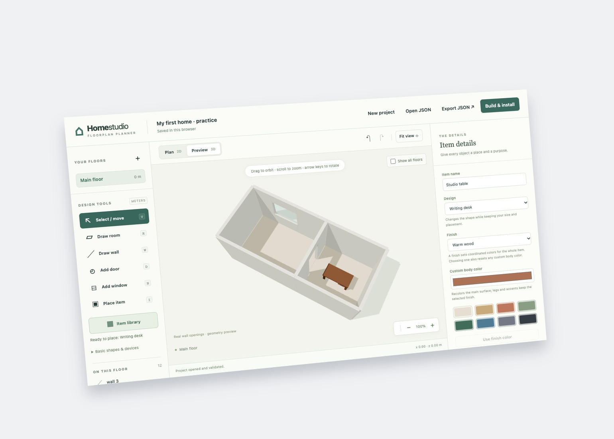

# Home studio

**Draw your home, explore it in 3D, and make it your Home Assistant dashboard.**

**[Try a furnished example](https://ha-homelab.github.io/home-studio/planner/?example=practice)** ·
**[Start your own plan](https://ha-homelab.github.io/home-studio/planner/)** ·
**[Get the latest stable release](https://github.com/ha-homelab/home-studio/releases/latest)**

[](planner/guide-assets/06-preview.jpg)

The existing illustrated-guide screenshot shows the real editor with the fictional
practice project, not a private home. Click for the unchanged readable original.

No account or installation is needed to try the editor. Start with room
measurements and walls, choose from 195 furniture designs, or open an editable
example and experiment. The editor supports 24 languages. When you are ready,
the local compiler and installer bring your plan into Home Assistant.

[](https://www.bestpractices.dev/projects/15584)

[](docs/fuzzing.md)

**[How we test and release Home Studio](docs/quality-and-release.md)** — illustrated
browser coverage, recovery checks, and verified release results.

**[Illustrated drawing guide](https://ha-homelab.github.io/home-studio/planner/guide.html)** ·
**[Install in Home Assistant](https://ha-homelab.github.io/home-studio/install.html)** ·
**[Saving and recovery](docs/first-session.md)**

Draw rooms, add walls, doors and windows, place furniture, and explore your
design in 3D. The browser editor needs no account or installation. Use a desktop
browser and a mouse or trackpad; the illustrated guide also reads on a phone.

The complete download includes the editor, a local project compiler, a Home
Assistant integration, and its local installer. The compiler and installer need
**Python 3.10 or newer**, with no extra Python packages. Home Assistant supplies
the integration's runtime dependencies.

The hosted editor stores a draft in your browser and does not connect to Home
Assistant. **Export JSON** saves your editable project; **Open JSON** restores it.
The local compiler turns that project into a separate viewer, 3D exports, and an
installable Home Assistant package. Examples and guide screenshots are fictional.

The compiled Home Assistant viewer gives walls a soft, rounded profile with a
transparent teal finish, cyan upper edges and blue lower edges. It keeps door
and window openings clear. Subtle color drift reuses existing desktop frames;
mobile devices and an idle plan stay still. See [wall rendering and resource
limits](docs/rounded-walls.md). Your measured drawing and exported geometry are unchanged.

## Choose your language

The drawing editor supports **24 languages**, including translated tools,
object names, palettes, patterns, dialogs, and accessibility labels. Choose a
language in the header; Arabic, Hebrew, and Persian support right-to-left text.
Your project names and entity IDs remain unchanged. Only the selected editor
language pack loads; no online translation service is used.

Read a [localized README quick start](docs/translations/README.md), or see
[translation scope and how to contribute](docs/i18n.md). The drawing and installation
pages include a localized quick route with illustrations and copyable commands.
The installed viewer also translates everyday navigation, placement controls,
and device states into all 24 languages. It follows your Home Assistant language
until you choose another language in the plan. The detailed reference, command-line
diagnostics, and advanced device diagnostics remain in English.

## Try device buttons without operating anything

Enable **Dry run** in the installed plan's host header. It blocks switches,
TV power, curtain operations, and native Home Assistant dialogs that can expose
lock or other device controls. Readings remain real; there is no simulated
success. Bookmark the plan with `?dry_run=1` to pin this browser's view in Dry run.
Navigation and saved placement editing continue to work.

Read [the Dry run guide](docs/dry-run.md) for the exact boundary, storage behavior,
and verification. The installer's `--dry-run` is a separate archive-validation
option. For operating notes and troubleshooting, start at the
[repository documentation wiki](docs/wiki/Home.md).

See the [illustrated process and results](docs/process-and-results.md) for the
command boundary, browser persistence, translation coverage and evidence behind
the change. Its workflow diagrams distinguish local verification from release
acceptance.


## Furnish your rooms

Open **Item library** to browse **195 designs in 22 categories**: furniture and
lighting, cushions and throws, curtains and blinds, rugs and tapestries, mirrors,
plants and life-size display bears, tabletop and bathroom accessories, pet furniture,
servers and electronics, toys, musical instruments and workshop tools,
vehicles, bicycles, sports gear, garden equipment, and more. Search for a
server rack, teddy bear, Tesla, café racer, moped, skis, or satellite dish, choose its thumbnail,
then click inside a room. You can also select a room and choose **Place item at
room center** for keyboard placement.

Select an item to change its **Design**, choose one of 18 coordinated **Color palette** themes,
or set a **Custom body color**. Fabric and decorative panels on supported designs
also offer **Surface pattern**: stripes, checks, diamonds, dots, herringbone, or
chevrons. Choose a separate **Pattern color**, or keep the palette’s accent. The
small item preview shows your choices immediately. **None** restores the original
surface; changing palette resets custom colors but keeps the pattern. Change its width, depth, height, elevation, and
rotation to match your measurements. A new design keeps your dimensions;
**Use design’s original size** restores the starting size. **Basic shapes &
devices** remains available for blocks, switches, outlets, and sensors.


The same furniture geometry and colors appear in the 2D drawing, 3D preview,
downloaded models, and installed HA plan. Export your project JSON as the editable
source. Older projects retain their basic shapes until you choose a design.
The library is bundled locally: no asset account, remote model downloads, or
additional runtime dependencies are required. The library opens with 24 designs;
**Show more** reveals the next set. Search and category filters cover every design.

Try the [color and pattern studio](planner/guide-assets/pattern-studio.json) to
compare all six patterns in a furnished room. Export your current drawing first,
open the example with **Open JSON**, select a rug or cushion, and try another
palette or pattern. Patterns apply to designated flat fabric/decorative panels,
not every curved surface. Curtains are static furnishings; this does not create
Home Assistant curtain controls.


Try the [fictional garage and creative studio](planner/guide-assets/garage-and-studio.json):
download the JSON, choose **Open JSON** in the editor, then **Preview 3D**. It
combines a car, motorcycle, bicycle, skis, server rack, teddy bear, music and art
supplies, and a patio. Export your current drawing first if you want to keep it.


Try the [decorated studio](planner/guide-assets/decor-studio.json) for floor and
wall textiles, a starburst chandelier, a wall sconce, a mirror, plants, a
balustrade, and a life-size bear. Wall designs already stand upright. Set their
bottom height with **y**, rotate them to face into the room, and inspect them in
3D. For ceiling lights, **y + Height** should reach your ceiling. The
[illustrated guide](https://ha-homelab.github.io/home-studio/planner/guide.html#table)
walks through these placements. Mirrors use stylized glass without a reflection
render pass; decorations do not introduce continuous animation.


These are original, simplified designs. Product-inspired names describe an
approximate silhouette, not a manufacturer-supplied model or exact dimensions.
Object libraries provide geometry; adding a server or car does not automatically
connect its telemetry to Home Assistant.

Furniture designs, palettes, and patterns are authored in the planner. After changing them,
rebuild and reinstall the project. The installed panel can move, resize, rename,
and bind existing furniture to entities; its inventory import is for placements,
not a way to download or replace furniture models.

## Draw, build, and preview

1. Follow the [drawing guide](https://ha-homelab.github.io/home-studio/planner/guide.html)
   and choose **Export JSON** in the editor. Keep that file as your source.
2. Open the [latest stable release](https://github.com/ha-homelab/home-studio/releases/latest),
   choose `home-studio-VERSION.zip` under **Assets** (not GitHub's **Source code**
   ZIP), extract it, and open a terminal in the extracted `home-studio` folder.
3. Check `python3 --version`. Use Python 3.10 or newer. On Windows, `py -3` may be
   your Python command; substitute it for `python3` in these examples.
4. Run the build below. Replace `/path/to/project.json` with your exported file's
   actual path. Put quotes around paths containing spaces.

```sh
python3 scripts/build-planner-project.py --project /path/to/project.json --output dist/my-home --ha-package
python3 -m http.server 8099 --bind 127.0.0.1 --directory dist/my-home
```

Open [the local preview](http://127.0.0.1:8099/) and choose a floor. Keep the
terminal running while viewing; press Ctrl+C to stop the server. The build also
creates `dist/my-home/home-floorplan.tar.gz`. Your preview has no live device
connection. The output folder must be empty or belong to an earlier compiler
build; keep editable source files outside it.

To draw in a downloaded copy, run the server without `--directory dist/my-home`
and open [the local editor](http://127.0.0.1:8099/planner/). Export and reopen JSON
to move between the hosted and local editors; they have separate browser drafts.

## Install in Home Assistant

The **0.9.0 beta series** also provides a Lovelace dashboard card and media-player
cover artwork. See [dashboard and artwork setup](docs/dashboard-and-media.md).
The next device-controls beta adds sensor and thermostat readings, native HA
controls on hover, and a compact audio remote. See [device controls](docs/device-controls.md).
These installed features require rebuilding with that beta toolkit; updating
the hosted planner alone does not update an existing Home Assistant panel.

In the installed **Home view**, choose **Rotate** to turn the map or **Move** to
pan it with a mouse or touch drag. Shift-drag and right-drag also pan; the
percentage button resets the view. See the
[Home camera controls](docs/first-session.md#rotate-the-installed-home-view)
for keyboard shortcuts and upgrade guidance.

Use the [complete installation guide](https://ha-homelab.github.io/home-studio/install.html)
for first-time setup, Home Assistant OS file transfer, and updates.

For a **local, writable Home Assistant config directory**, replace the config
path below with the directory containing your `configuration.yaml`:

```sh
python3 scripts/install-home-assistant.py dist/my-home/home-floorplan.tar.gz --config /path/to/ha/config --dry-run
python3 scripts/install-home-assistant.py dist/my-home/home-floorplan.tar.gz --config /path/to/ha/config
```

The dry run validates without changing files. The installer requires an existing
directory, refuses symlink destinations, and installs only
`custom_components/home_floorplan`. It does not use a Home Assistant URL or token.
For Home Assistant OS, build and validate on your computer, then follow the
guide's **Samba copy** route; a browser connection to HA is not a local config path.

An existing component requires **`--replace`** on both commands. Stop Home
Assistant Core before the real replacement, using a host or console connection
that can start it again. The installer retains the previous component in
`config/.home-studio-backups/` and prints the exact backup path. It preserves
`configuration.yaml` and `.storage`; a component backup is not a full HA backup.

After installation, merge this top-level entry into `configuration.yaml` once:

```yaml
home_floorplan: {}
```

Keep an existing entry instead of adding a duplicate. Run Home Assistant's
configuration check, then start or restart Core. Sign in as an administrator and
open **3D Home**. Use **Edit layout → Plan & placement** to link items to actual HA
entity IDs, and wait for **Saved in Home Assistant**. Device actions need an
explicit click; unknown or unavailable entities cannot be controlled.

The generic package uses HA's own authentication. It does not install HACS,
configure SSO, trace photos, or activate household-specific TV, camera, or RF
sensing adapters.

## Draft from room photos with your own AI

Run the optional local companion with Python 3.10+:

```sh
python3 scripts/serve-ai-planner.py
```

On Windows: `py -3 scripts/serve-ai-planner.py`. Choose **Plan from photos** in the
local editor, connect your provider or local vision model, and add photos,
instructions and measured dimensions. Furnish an existing room or create a measured
rectangular room, preview the suggestions, then apply one undoable edit. The normal
editor, JSON export and Home Assistant installation workflow remain the same.

Credentials stay in temporary companion memory and out of project/browser storage.
Cloud generation sends the chosen data and authentication key to your provider;
local generation requires a loopback model runtime. There is no Home Studio AI relay.
The hosted website does not collect keys, and the installed HA viewer has no AI dependency.
Adapters are mock-tested; exact live model compatibility still needs a user smoke test.

[Quick start](https://ha-homelab.github.io/home-studio/ai-setup.html) ·
[Workflow and privacy](docs/ai-planning.md) · [Provider setup](docs/ai-provider-setup.md) ·
[Local models](docs/ai-local-models.md) · [Architecture](docs/ai-planner-architecture.md)

## Shared code, private homes

The public compiler, viewer, integration core, and installer can also be used by
a private project. Keep plans, photos, entity bindings, credentials, and any
`private_site` / `private_site_config` extensions in that private project.
Generic packages require `site.json` with `site_features: false`; enabling private
adapters requires a separately prepared private package and the installer's
explicit `--allow-site-features` flag. This flag does not supply those adapters.
See [the architecture guide](docs/architecture.md) for the boundary and storage
behavior.

Read [privacy and storage](https://ha-homelab.github.io/home-studio/privacy.html)
before sharing a project. A generated viewer or archive contains your floorplan
and bindings. Keep your real home's source and generated files private.

## Checks and publication

```sh
python3 scripts/test-public-package.py
python3 scripts/test-install-home-assistant.py
python3 scripts/generate-furniture-catalog.py --check
python3 scripts/test-furniture.py
node scripts/test-i18n.mjs
python3 scripts/validate-site.py
python3 scripts/validate-site.py --output _site
```

For browser regression checks, install Node.js 22 or newer, run
`npm ci --ignore-scripts`, then `npx playwright install chromium firefox` and
`npm run test:planner`. On a Linux CI host, use
`npx playwright install --with-deps chromium firefox`. Run
`node scripts/test-browser-stability.cjs` for multi-light interaction and WebGL
recovery checks in both engines. Run `node scripts/test-planner-stability.cjs`
for two-floor drawing, furniture dragging, preview orbit, and graphics recovery
in the browser editor. See [browser compatibility](docs/browser-compatibility.md)
for rendering budgets, measured coverage, and a safe bug-report checklist.
The public CI gate also requires [cross-platform acceptance](docs/platform-acceptance.md):
package installation on Linux, Windows, and macOS; pinned Chromium, Firefox,
and WebKit generations; Chrome and Edge channels; native Firefox and Waterfox;
and native Safari on macOS. Phone and tablet viewport checks supplement desktop
coverage. The linked matrix distinguishes emulation from physical-device testing
and records the exact versions actually launched.
These are development tools only;
users do not need Node.js or Playwright to draw, compile, or install a plan.
The browser test exports a real drawing and installs that exact file's package
into a temporary config directory without contacting a live HA instance.


The [illustrated quality guide](docs/quality-and-release.md) explains what each
stage proves, how to inspect its public evidence, and which environments still
need testing on real hardware.

The public repository contains the full package. GitHub Pages publishes only an
explicit website allowlist, so the website stays a static editor and guide.
Validation checks links, browser imports, symlinks, and common private-data
patterns. These checks supplement review; they do not prove all future text or
image pixels are free of personal information.

Report bugs with browser details and a fictional example. Do not attach tokens,
credentials, or a real home design to a public issue.

Home studio is available under the [MIT license](LICENSE). The bundled Three.js
license and notices are in [vendor/THREE-LICENSE.txt](vendor/THREE-LICENSE.txt).

TV preview cards provide power controls and link to their screen positions with
cyan dashed leaders. Optional notification clips link to their camera positions.
Images require the site-specific adapters; the public installer does not capture
TVs or cameras by itself. See [linked media previews](docs/architecture.md#linked-tv-and-camera-previews).

### Lower-floor context

In **Whole floor** view, the nearest lower storey appears as muted architectural outlines beneath the active floor. Use **Lower floor outline** to hide it. Selecting a room hides the context automatically; returning to Whole floor restores your choice. Only the active floor has labels and device controls, and its zoom and framing stay unchanged.

For a planner project, draw all floors against the same X/Z origin and set their `elevation_m` values to their finished-floor heights. For example, use `0` for the ground floor and `2.9` for an upper floor 2.9 metres above it. The compiler selects the nearest lower elevation regardless of list order. A single-floor project needs no changes. Model downloads remain separate floor models.

Site builds can also add muted, read-only vehicle or energy cards in unused space.
These reuse Home Assistant state updates and show the last reported measurements.
Power labels beside objects appear only above zero. They do not add controls,
poll devices or cover the active floor; see [passive telemetry](docs/architecture.md#passive-telemetry-and-power-labels)
for the optional site-model bindings.

## Release validation

Public release candidates run bounded, offline mutation tests against project
validation and geometry. See the [fuzzing guide](docs/fuzzing.md) for targets,
budgets, synthetic data rules and reproduction, and [release instructions](RELEASING.md)
for versioned source ZIPs. Beta builds and ordinary pull requests do not run
mutation campaigns.


## Contributing and security

See [contribution and test requirements](CONTRIBUTING.md), [private security reporting](SECURITY.md), [governance](GOVERNANCE.md) and the [roadmap](ROADMAP.md).

## Screenshot artwork

Regenerate the perspective cover with `bash scripts/render-docs-hero.sh`
(ImageMagick 7). It preserves the original screenshot and only adds a geometric
projection and shadow. The linked flat image remains the readable reference.
