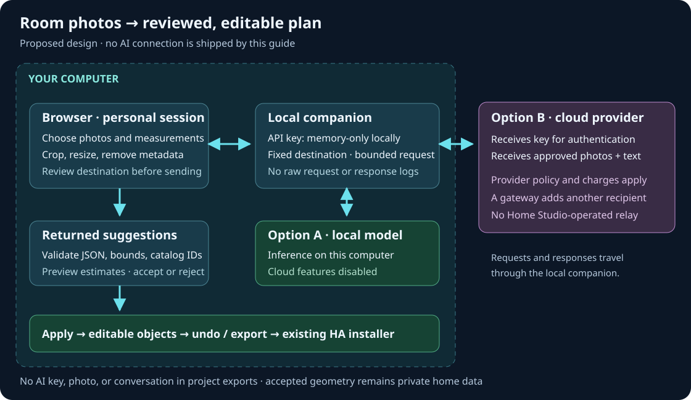

# From photos to an editable plan

Home Studio can draft from photos directly in the [native Home Assistant
editor](home-assistant-editor.md). It can furnish an existing measured room or
create a measured rectangular room with proposed doors, windows and furniture.
The **Site & roof** scope adds approximate house envelopes, flat roof outlines,
neighboring buildings, streets and landscape to the editable site.
The result is ordinary editable Home Studio geometry, not a picture. Manual
drawing needs no AI setup. The standalone local companion is also available;
the public hosted editor never collects keys or calls a model.

Provider adapters are implemented and tested with synthetic requests and mock
responses. This is **not** a claim that every provider/model combination has passed
live inference. Models, permissions, prices, and API capabilities change. Check your
chosen vision model using a fictional room before submitting private photos.

- [Illustrated-site entry and quick start](../ai-setup.html)
- [Cloud accounts, API keys, and provider-specific setup](ai-provider-setup.md)
- [Ollama, LM Studio, llama.cpp, vLLM, and LocalAI](ai-local-models.md)
- [Implementation, boundaries, and acceptance tests](ai-planner-architecture.md)

## Start inside Home Assistant

Open **Home Assistant → Home Studio → Plan from photos** as an administrator.
Connect your provider and exact model ID, then follow **Make a draft** below.
The integration supplies the AI transport; no separate Python process or JSON
transfer is required. After applying a proposal, **Save draft** and **Publish to 3D Home** in the same page. A local-model endpoint refers to the HA machine's
network namespace; `127.0.0.1` does not refer to the browser's computer.

## Optional separate desktop companion

Extract the complete source toolkit, open a terminal in that folder, and run:

```sh
python3 scripts/serve-ai-planner.py
```

On Windows use `py -3 scripts/serve-ai-planner.py`. Python 3.10 or newer is required;
no additional Python packages, Node build, cloud account, or Home Assistant access
is needed to start it. The command opens the local editor. Keep the terminal open;
Ctrl+C stops the companion. Use `--no-browser` to print the address without opening
it, or `--port 8100` when the default port is already occupied.

If you started in Home Assistant, use **Save draft** and **Export JSON** there,
then **Open JSON** in the local editor. The same export/import steps apply to a
drawing from the optional hosted editor. These editors have separate drafts and
do not transfer source automatically. Do not serve the AI files with a generic
static server: it has no AI session service. Use the native HA integration or
the companion to supply the restricted API.

## Make a draft

1. Choose **Plan from photos**. Select your provider, enter an exact model ID that
   supports images and structured text, and connect. Plan for at least a 32,768-token
   context window, including an 8,192-token output allowance; larger inputs can
   need more. The catalog and image tokens count toward that budget. For a cloud provider enter
   your own API key. For a local runtime enter its numeric loopback endpoint and
   authentication token if its configuration requires one. Connecting records
   the settings locally; it does not upload photos or prove model access.
2. Choose **Furnish selected measured room**, or **Create a measured rectangular
   room**. The second mode needs width, depth, ceiling height and the new room's
   origin in metres. On an existing floor, match its ceiling height. Each room's
   position is explicit; unrelated photos do not establish adjacency.
3. Add up to six JPEG, PNG or WebP photos, then write instructions. You can write
   in your own language; this initial AI interface is English. Images are optional
   for a text-only draft. Convert HEIC to JPEG first. Explain the reference wall,
   camera direction, measured dimensions, furniture you want to keep, and which
   details are uncertain. The context disclosure shows what room data is sent.
4. Choose **Generate draft**. Only this action sends an inference request. It can
   incur provider charges. There is one generation at a time and no automatic
   retry, model switch, paid fallback, or background photo upload.
5. Review candidate objects, assumptions, missing measurements and warnings.
   Preview in 2D and 3D, select candidates, and correct dimensions before applying.
   The preview is detached: autosave, export and build still use the accepted plan.
6. Confirm the review and **Apply selected additions**. This is one undoable edit.
   Cancel or discard leaves the accepted plan unchanged. If the plan or selection
   changes while the model is working, the old result cannot be applied.
7. Adjust the result with the normal editor and link devices yourself. Repeat for
   another room, then **Save draft → Publish to 3D Home** inside HA. If using the
   separate companion, Export JSON and use **Open JSON** in HA first. Existing
   portable deployments can use the [portable installation reference](../install.html#export).
   Published viewer assets contain no AI credentials or source photographs.

Example instruction:

> The room is 4 m wide and 3 m deep, with a 2.7 m ceiling. Photo 1 faces the top
> wall in the drawing. Keep the desk near the window. Add a two-seat sofa against
> the opposite wall and leave the doorway clear. Flag estimated furniture sizes.

Photos cannot reliably establish scale, hidden walls, or exact depth. They are
reference evidence, not a survey. Vision models have documented
[spatial-reasoning limitations](https://developers.openai.com/api/docs/guides/images-vision).
New-room creation currently uses measured rectangles. Draw irregular rooms
manually, then use the furnishing mode. Existing walls, objects and entity bindings
are preserved. Openings are proposed only when creating a new room. Shared walls
must match exactly; partial overlaps require manual drawing.

## Add site and roof features from photos

Opening **Plan from photos** while editing **Site & roof** selects exterior
planning automatically and keeps the current **Neighborhood** or **All site
features** scope. Reopening it from **Inside** restores your last room planning
mode. Identify your own home in the required field, describe which roofs, neighbors, streets and landscape
to include, and supply any known dimension and orientation. For example: “The white
house in photo 1 is mine; its front wall is 10 m along +X. Include its roof, the
neighbor to the right, and the street toward +Z.” X points right and Z down in 2D.

Choose your own photos or [permitted reference imagery](site-editor.md#choose-reference-imagery).
Keep required attribution and check that you may submit the images to your selected
provider. A screenshot is not automatically licensed for AI extraction. You can
always draw the same exterior shapes manually in **Site & roof** without an AI key.

Review the disclosed context before **Generate draft**. Both site scopes send
existing site features, your descriptions, instructions and selected processed
photos. **Neighborhood** uses existing home/roof outlines for alignment when
available. Otherwise it sends just one approximate rectangle enclosing the
drawing's rooms and walls; this is an alignment hint, not the actual footprint.
An empty drawing sends no reference geometry. Individual room outlines, room and
floor names/IDs, floor elevations, furniture, bindings and private notes are
excluded from neighborhood context.

**All site features** additionally shares every room outline and floor elevation,
which reveals the indoor layout; it excludes room names/IDs, furniture, bindings
and private notes. The selected provider, local photo processing, session privacy
rules and explicit Generate action are the same as for room drafting.

Review each proposed feature, its evidence, assumptions and missing measurements.
You can deselect features and correct polygon coordinates and heights before
confirming **Apply selected additions**. Existing site features, ground elevation,
interior geometry and entity bindings are preserved. Applying is one undoable edit;
changing the plan or request invalidates the draft. Photos remain approximate
visual references, not a survey or exact photogrammetry. Roofs are flat outlines at
the specified height; pitch and facets are not represented. No latitude, longitude
or map location is inferred from photos. See the [site editor guide](site-editor.md)
for manual adjustments and map alignment.

Selected photos remain session inputs and are excluded from the saved drawing.
Applied site geometry persists in project backups and generated viewers. Even
without GPS coordinates, a recognizable neighborhood can reveal its location;
keep real projects private and use fictional geometry in public examples.

## Where the key and photos go



In native mode, the browser sends the key through your authenticated HA connection
to a user-bound session in HA memory. Use HTTPS for remote access. In the separate
companion, it sends the key to that local process instead. On Generate, the HA
integration or companion sends the key to your chosen provider to authenticate.
The chosen photos, instructions, sanitized room context and catalog vocabulary
travel to that provider for inference. OpenRouter and other gateways add their upstream processing boundary.
Site requests send the disclosed site context described above instead of the room catalog.
Home Studio has no operated AI relay, key database, or photo collection.

**A cloud API key is not “never transmitted.”** It stays out of persistent Home Studio
storage, but must reach the selected provider. Provider retention and billing rules
still apply. OpenAI Responses requests use `store: false`; that does not disable all
[provider retention](https://developers.openai.com/api/docs/guides/your-data).

In local mode, both transports accept numeric loopback endpoints only. It does not
support LAN, arbitrary cloud proxies, or user-selected remote URLs. The runtime's
own cloud features, telemetry, downloads and logging are separate. Disable cloud
fallback and check the actual runtime configuration before claiming local-only
inference. Ollama models named with `:cloud` or `-cloud` are rejected by the profile.

Credentials are kept only in process memory for the connected page session, for at
most 30 minutes. End session clears the connection; restarting HA or the companion
clears its sessions. Native integration unload also cancels work and clears keys.
Reloading creates a separate disconnected session. Abandoned sessions
expire even if a browser-close event is lost. No key goes into localStorage,
sessionStorage, cookies, project JSON or exported Home Assistant files. Browser
extensions, local administrators, operating-system swap and crash dumps remain
outside this memory-lifetime guarantee.

Photo processing happens in the browser: asynchronously in the native editor's
opaque iframe, or in a worker for the companion. The shared decoder receives no
credentials and makes no network requests. It resizes and re-encodes images to
strip metadata. This does not remove people,
readable documents or private possessions from the visible image. Crop those before
selecting the file, while preserving required imagery attribution. The HA backend
and companion do not decode pixels or write photographs to disk. Ending the session
clears Home Studio's selected photos; it cannot delete copies retained by a provider.

## Bounds and failure behavior

- Source images: at most 6, 10 MiB each, 30 MiB combined, 24 megapixels each.
- Prepared images: at most 1600 pixels on the longest side in the UI. The server
  independently caps individual/combined byte size and header dimensions.
- Model reply: at most 256 KiB for the draft; at most 64 proposed furniture items.
- Site geometry: at most 64 features, 3–64 vertices per polygon and 1024 vertices
  in total, including existing features. Coordinates stay within ±1000 m and
  heights within 0–100 m; streets and landscape have zero height. Polygons must
  be simple, with no crossings or repeated closing vertex.
- Network generation: bounded to 90 seconds; no retries or redirect following.
- Only catalog models/styles/patterns are accepted. No generated code, remote model
  URLs, tools, Home Assistant services or entity bindings are accepted.
- Rotated object footprints must stay in the room, including concave boundaries.
  Heights, wall openings, identifiers, duplicate JSON properties, project size and
  collection limits are validated before preview or apply.
- Overlapping furnishings and obstructed openings produce review warnings: a rug
  under a table is legitimate, so not every overlap is an error.

A refusal, truncated or malformed response, invalid geometry, expired session,
timeout or cancellation does not replace the drawing. Fix the instructions or
configuration and explicitly retry. The manual editor works without any AI service.

## Verification scope

Automated tests use synthetic images and local mock servers, not household photos
or paid accounts. They exercise protocol serialization, authentication boundaries,
expiry, cancellation, redirect refusal, size limits, malicious output, detached
preview, apply/undo, storage exclusions and ordinary project compilation. The test
commands and CI lanes are documented in the [architecture guide](ai-planner-architecture.md).
Successful mocks prove the application contract; they do not prove model accuracy,
current provider availability or the privacy configuration of a third-party runtime.
