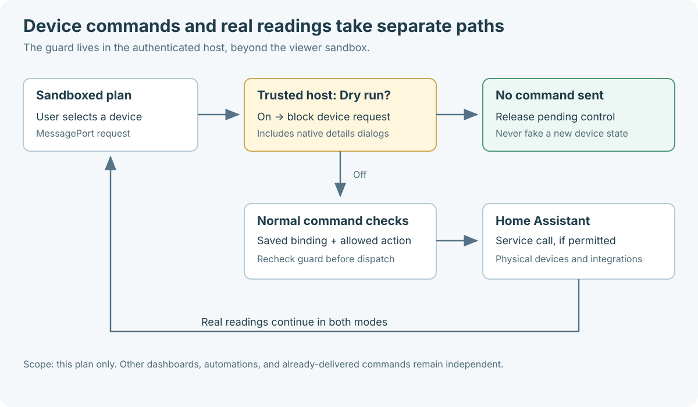

# Shared code and private homes

Home studio has a public drawing and installation pipeline. A private household
project can use the same code while keeping its measurements, photos, device
bindings, deployment details, and specialized adapters outside the public repo.

See the [illustrated quality and release guide](quality-and-release.md) for how
we test both browser paths, recover graphics resources, and qualify a release.

## From drawing to installed panel

The [AI-assisted authoring workflow](ai-planning.md) adds an optional loopback
companion for personal provider sessions, photo processing and validated drafts.
Its modules are loaded only by the companion, not the hosted manual editor or
installed viewer. See [AI architecture](ai-planner-architecture.md) for the implemented
request, privacy, geometry and transactional preview boundaries.

1. **Browser editor:** `planner/index.html`, `editor.js`, and `model.js` edit a
   versioned metric project. The draft stays in browser storage. Exporting JSON
   makes a portable source file; the browser does not contact Home Assistant.
2. **Local compiler:** `scripts/build-planner-project.py` calls
   `planner/project.py`. It validates the source, generates floor geometry and
   self-contained viewers, and writes model exports. `--ha-package` also creates
   `home-floorplan.tar.gz` from reviewed integration files and the new assets.
   Python 3.10+ and the standard library are enough for this build.
3. **Local installer:** `scripts/install-home-assistant.py` validates the archive
   and stages its files before replacing a component directory. Its only target
   is `custom_components/home_floorplan` inside the explicitly supplied config
   directory. An update needs `--replace`; previous files are retained outside
   `custom_components` in `.home-studio-backups`. It does not edit YAML, contact
   an HA endpoint, copy a token, or start or stop a running service.
4. **Home Assistant integration:** the installed backend loads the project's
   `site.json` and floor assets. The generic `static/panel.js` uses Home
   Assistant's authenticated connection to display **3D Home** to administrators.
   Private floor assets are delivered through authenticated backend commands.

The [installation guide](https://ha-homelab.github.io/home-studio/install.html)
covers the commands, manual YAML entry, restart, and Home Assistant OS file
transfer. Installation is a local file operation, not a hosted wizard or HACS
installation flow.

## Editor language boundary

`planner/i18n.js` loads English and the locale manifest at startup. It selects an
allowlisted language from the URL, stored preference, or browser settings, then
imports only that language's local module. A request revision prevents an older
download from replacing a more recent selection. No translation API is involved.

The editor translates explicit message keys and catalog labels. Project data,
entity IDs, geometry, and history remain independent of presentation language.
An interface refresh preserves unfinished inspector fields. Right-to-left
locales change text layout while numeric coordinates, code, and canvas controls
keep their original orientation.

`planner/validation.js` carries a message key, literal values, and explicitly
marked field labels alongside each user-facing validation error. The UI formats
these in the current language; the original English `Error.message` remains
available for callers and parity tests. User-authored names never become
translation keys. Technical schema diagnostics may remain in English.

The compiler does not copy editor language packs into the installed HA viewer.
The public source archive includes them and the translated README quick starts.
See [language coverage and contribution rules](i18n.md) for the supported scope
and the contract and browser checks enforced by CI.

### Help pages and the installed viewer

`planner/help.js` adds a localized, illustrated quick route above the existing
English drawing, installation, and publishing references. It reuses translated
editor terminology and a small `help-locales.js` dictionary for installation
guidance. The original reference remains readable without JavaScript. Literal
commands stay left-to-right and are never passed through translation.
`planner/language-links.js` carries the selected language only to recognized
same-origin editor/help routes; downloads, external links, and anchors retain
their meaning. No project content is placed in a URL.

`viewer-i18n.js` is a separate small runtime for generated plans. The compiler
embeds its explicit `viewer-locales` dictionaries as script-safe JSON inside
each self-contained viewer. This avoids remote dependencies and relative locale
requests from the opaque-origin HA iframe. The viewer uses explicit text and
attribute markers, preserves inventory and unsaved placement fields, and updates
existing controls when the language changes. Geometry, IDs, user names, and
service actions are not localized. Advanced diagnostics remain English.

The authenticated `static/panel.js` host remembers language alongside the
existing view preferences. A language-only `view_preferences` message cannot
reset the sidebar state, and a sidebar-only message cannot reset language. The
host accepts only canonical allowlisted codes on the established MessagePort;
stale viewer generations and recovery mode reject preference updates. Without
an explicit choice, the host follows the HA profile language. It never exposes
storage, tokens, or arbitrary HA attributes to the iframe for localization.

Website preferences cannot automatically cross into a different HA origin.
Offline previews use their own browser preference; installed plans receive
the HA host preference. Neither changes the project schema. Update compiler
and viewer sources together when consuming this package in a private builder.

## First-session authoring and recovery

The landing page links directly to four fixed fictional examples. The planner's
`onboarding.js` accepts only their allowlisted IDs; it lazily imports local
`planner/examples/*.js` modules. No arbitrary URL is fetched, and the hosted
editor keeps `connect-src 'none'`. Example modules contain the same source data
as the downloadable lesson JSON. Edit the canonical `planner/guide-assets/*.json`
files, then run `python3 scripts/build-example-modules.py`; CI checks generated
bytes and validates each example through the project model. Loading an example uses the same project
replacement boundary as opening a file, and consumes the launch query so a
reload does not overwrite subsequent edits.

The measured starter adds a room and, when requested, its wall outline in one
history transaction. It uses the existing geometry model and does not infer a
new wall topology. Rooms, walls, openings, and furnishings remain separate
objects. This small entry point reduces setup work without changing schema 1.

`draft-storage.js` owns persistent draft arbitration and recovery. A stored
revision comparison detects competing changes, with Web Locks serializing
cooperating tabs where available. An older tab running a previous release does
not participate in that lock protocol; byte comparisons detect many such changes
but cannot make an older client's writes atomic. Recovery decisions are explicit: load the
saved version, export the current version, or deliberately replace the stored
copy. One validated previous-project checkpoint is retained for project
replacement. Damaged raw data has its own download path. Browser storage is a
convenience cache, not a backup; JSON export remains the portable source.

`inspector-dom.js` preserves editing continuity when inspector controls are
refreshed. Invalid values remain visible for correction, and normal Tab or
pointer navigation must retain the intended next field. Browser regressions
cover this interaction alongside recovery after reload and multi-tab writes.

The installed viewer's graphics-recovery banner is outside the editor-only
container, so Home mode cannot hide an initialization failure. Renderer-dependent
lighting setup is guarded, and a failed first draw stops the initial render gate.
The 2D placement/export path remains reachable without retrying a broken 3D draw.
See [the first-session guide](first-session.md) for the user-facing workflow.

## Furniture authoring and export

`planner/catalog.json` is the canonical, versioned library of original low-poly
designs. It defines categories, coordinated material palettes, dimensions, and
normalized box, cylinder, sphere, ring, and cone parts. `scripts/generate-furniture-catalog.py` validates
the recipes and generates `planner/catalog.js`; `--check` fails on drift. The
browser imports the generated module directly, preserving the editor's
`connect-src 'none'` policy. Neither thumbnails nor models need a network request.

Project schema version 1 adds optional `model_id`, `style_id`, `color`,
`pattern_id`, and `pattern_color` fields (colors use `#RRGGBB`) to inventory items. The JavaScript and Python validators check
model membership, semantic type, and palette membership. An item without these
fields follows the existing basic-shape path; there is no guesswork based on its
name. A palette changes coordinated surfaces and clears body/pattern color overrides,
while preserving the selected pattern.
The custom color changes only the designated body surface, preserving accents.

`planner/furniture.js` and `planner/furniture.py` expand the same recipes into
matching indexed triangles, outward normals, and linear RGB materials. X/Z span
−0.5 to 0.5; Y spans 0 to 1. An item's dimensions scale that normalized geometry,
then its rotation and position place it on the floor. Tests compare every model
across the two implementations and inspect actual exported vertex/material data.

A sphere is a low-poly ellipsoid with 48 triangles. A ring is a thick annular
cylinder around local Y with 96 triangles and an optional `inner_ratio` (default
0.72). Inner ring faces point toward the hole. A cone has a closed 12-sided base
at local `y - height / 2` and an apex at `y + height / 2` (24 triangles total).
It gives trees and shades a tapered silhouette without extra assets or dependencies.
Optional per-part
`rotation_deg: [x, y, z]` rotates about the part center in X, then Y, then Z
order, before item scaling. Existing boxes and cylinders retain their geometry.
The generator checks finite numbers, positive sizes, valid material roles,
unique metadata, and bounds from actual transformed vertices. Each model has
at most 32 parts. New designs belong in `catalog.json`; regenerate `catalog.js`
with `python3 scripts/generate-furniture-catalog.py` and run both geometry suites.

### Pattern surfaces and bounded geometry

A recipe may mark up to three box parts with `pattern_face: "top"` (+Y) or
`"front"` (+Z). The marker does not change its unpatterned geometry. Six shared
pattern identifiers are exported by both builders: `stripes`, `checks`,
`diamonds`, `dots`, `herringbone`, and `chevrons`; absent/`none` preserves the
original meshes. An active pattern on an unsupported design is rejected, as is
a pattern color without an active pattern. Pattern panels use the body material;
the pattern defaults to the palette accent, or the explicit `pattern_color`.
The editor clears a pattern when changing to an incompatible design.

The builders partition the marked face instead of layering coplanar polygons.
Its background triangles remain in the original `part_N` mesh and all accent
triangles join a single `pattern` mesh. This preserves exact bounds and outward
normals, including after per-part rotation, with no depth fighting or shader or
texture dependency. The six patterns add respectively 10, 30, 52, 106, 126, and
94 triangles per marked face, at most 378 extra triangles per item. They add at
most one new material batch; no-pattern items retain their existing geometry.
The generator enforces the three-face limit.

The 2D drawing uses height-sorted top-facing triangles for patterned items,
without strokes on internal triangle edges. Other items retain their compact
silhouette path. Appearance caches include both pattern fields; the item-detail
preview uses the same bounded thumbnail cache as the library. The full pipeline
bakes identical geometry into GLB, OBJ/MTL, DAE, USDA, SVG, and installed HA assets.
`test-furniture-patterns` verifies JS/Python parity, rotated bounds, face coverage,
exports, invalid values, and unchanged unpatterned meshes. Browser tests exercise
pattern edits, Undo, palette resets, incompatible design changes, downloaded JSON,
and rebuilt HA viewer metadata while retaining a moved object's placement.

Dimensions describe the complete object, including its frame, pot, fringe, or
ceiling mount. `elevation_m` sets the starting bottom height, not the center.
Wall textiles and mirrors are upright thin models with their decorated face
toward local +Z; rotate the whole item around Y to face into the room. Floor
textiles are separate flat models, so they do not need a new item rotation axis.
Wall lamps use type `lamp`, and suspended lights use `chandelier`; their entity
bindings remain optional. Mirrors use a pale glass material, not a reflection
render pass. Plants, ornaments, and display bears have no animation or network
dependency. The `decor-studio.json` example demonstrates these conventions in
one fictional room and runs through the same browser/export/install checks.

The editor uses cached CPU thumbnails, height-sorted top surfaces for 2D, and the
same parts for the 3D preview. A rug placed after a sofa remains below it. The
preview renders only when needed; choosing furniture introduces no idle frame
loop. Undo, local drafts, and JSON export store the recipe identifiers rather than
triangle buffers. The library renders 24 thumbnails at a time; search covers the
whole catalog, and Show more focuses the first newly added card for keyboard
users. Its pixel cache retains at most 32 thumbnails. Geometry and top-view
caches are bounded independently of catalog growth. The full library is not
copied into the installed HA runtime.

The planner shares immutable catalog-part geometry within each 3D rebuild. A
positively identified Apple Software Renderer additionally instances repeated,
disjoint opaque parts to reduce draw submissions. A bounded sweep excludes
furniture that intersects other items or architecture, retaining its ordinary
materials and draw order;
dense scenes fall back to ordinary meshes. Native, unknown and other software
renderers, including SwiftShader, retain the ordinary path. Instancing preserves
geometry, colors, lights and logical item/part counts, but its GPU transform
arithmetic can produce small rasterization
differences. Separate shader variants can add first-use compilation; fewer draw
submissions do not guarantee a faster first load. The diagnostic mesh count
reports actual draw meshes. Every rebuild
explicitly disposes instance buffers and shared geometry; there is no persistent
GPU cache or additional idle rendering.

The legacy Apple software rasterizer uses diffuse Lambert materials for lit
surfaces and unfiltered shadow maps. Its fragment interpreter spends substantial
time in the PBR material shader even when no room light contributes. These lit
surfaces keep geometry, colors, opacity, emission, clipping, room confinement,
daylight and every linked light. Architectural wall fill instead uses an unlit
Basic material in both Home and Editor: it retains its teal color, opacity,
geometry, cutaway clipping, outlines and full-height shadow casting, but does
not receive lighting, daylight or shadows and has no view-dependent or animated
sheen. In the Editor only, supported opaque static floors use constant-tint
Basic materials, without received lighting or shadows. The separate authoring
backdrop plane is hidden on this profile, while the grid and real floor geometry
remain visible. Home already hides that backdrop; other profiles are unchanged.
Its existing material and geometry are retained for the normal ownership and
context-restoration lifecycle. A bounded lazy material cache restores each
original floor material
object before Home lighting attachment and releases active and dormant GPU
associations on context loss. Geometry, clipping, floor shadow casting, furniture
and outlines are retained; unsupported materials keep their original path.
Metallic/specular highlights and soft shadow filtering are also omitted
on this backend. Native and other software renderers retain the existing
Standard materials, unless the measured masked-Apple capacity check selects the
same diffuse fallback. Material selection is separate from catalog instancing;
TV screens and unlit overlays keep their own materials. See the
[profile and qualification notes](platform-acceptance.md) for this visual tradeoff.

Eligible packed Home shaders use three bounded RGBA32F tables: point records
and dynamic room/window signals, ordered light runs, and immutable room geometry.
Selection checks dimensions, sampler limits, exact integer metadata and finite
Float32 values before compiling; unsupported inputs retain the uniform path.
The constant-two point attenuation helper has an independent exact-input proof,
so four shader/cache states preserve either valid optimization without forcing
the other. Editor shaders retain their original path. Context loss retains CPU
records for reupload, and teardown releases the owned textures. These changes
preserve lighting order and arithmetic; they do not establish an Intel timing
improvement. See [platform acceptance](platform-acceptance.md) for the required
runtime checks and fallback coverage.

The compiler creates transformed meshes for GLB, OBJ/MTL, DAE, USDA and the
downloadable plan SVG. Item namespaces include their ordinal to avoid collisions
between a user identifier and a generated part suffix. Runtime model data retains
only normalized `object_assets` plus placements for furniture, omitting duplicate
transformed meshes. The installed viewer batches each item's parts by material.
Its editable SVG background excludes baked furniture silhouettes so a moved or
deleted item leaves no ghost behind.

HA placement validation preserves bounded appearance metadata without importing
the authoring catalog. The installed editor retains it when moving, renaming,
resizing, or binding an item, and clears it when changing semantic type. Changing
designs, palettes, or patterns requires rebuilding the project; inventory imports reject
changed appearance metadata instead of silently displaying an old baked color.
When a rebuilt project loads a previously saved layout, its compiled appearances
replace stale appearance metadata while positions, sizes, names, and entity
bindings remain intact. The viewer reports this refresh. An intentionally basic
object stays basic; a removed or incompatible design falls back to a basic shape.
Generated model downloads describe the compiled project, not later HA placement
edits. Keep the planner JSON as the design source.

The complete package includes the source catalog and both geometry builders;
Pages publishes only browser modules and the illustrated guide. CI exercises
all 195 designs, legacy projects, real export formats, a maximum-single-floor
256-plant build/install case, a mixed full-catalog installation, browser editing/history/import, and installation of
the browser's actual exported file. Installer file and total-size limits remain
unchanged: 32 MiB per file and 96 MiB in total. The 256-item count ceiling is not
a guarantee that every combination fits: hundreds of detailed bicycles or plush
toys can exceed archive limits. Use fewer detailed objects or basic shapes for
distant/repeated items, and run the installer dry run before deployment. The
full mixed 195-design regression stays below these limits. Palettes and custom
body colors do not add geometry. Patterns do: dense floors containing many
detailed or patterned items can reach those same archive limits. Start with a
small representative room, use None on distant objects, and check the installer
dry run. Entities and telemetry remain separate from the visual catalog.

## Public integration core

The public integration includes `__init__.py`, `site.py`, `validation.py`,
`curtains.py`, `manifest.json`, and `static/panel.js`. The compiler supplies the
site manifest, floor assets, and empty generic adapter configuration. Normal
packages declare `site_features: false` and a stable project `site_id`.

The core handles administrator access, floor selection, validated placement
saves, model downloads, and supported entity controls. It uses the current HA
session; there is no separate account, automatic SSO setup, or browser token
entry. Linking a TV or sensor places that entity in the plan, but does not add a
household's specialized TV capture, camera routing, or RF sensing behavior.

The floor viewer runs in a restricted iframe. The host and viewer communicate
through a dedicated message channel. The host checks saved entity bindings and
allowed actions before a user-initiated device command. The public static panel
script does not need a floorplan, photos, or credentials embedded in it.

### Dry run at the command boundary

The host owns the per-browser Dry run preference. It filters device requests at
the MessagePort boundary and checks the guard again immediately before service
dispatch. Only explicitly non-device message families pass while it is active;
new message types are not implicitly trusted. Native HA details dialogs are
blocked too, because their lock and device controls live outside the iframe.

A blocked request returns `command_result` with `dry_run: true` and `ok: false`.
The viewer clears its pending interaction without synthesizing a state change.
Real HA readings continue over the independent state path. Placement saves,
exports, navigation, and language preferences are still allowed; this is not a
read-only policy for saved layout data or other Home Assistant clients.

See [the complete guard contract](dry-run.md) for URL pinning, storage failures,
dispatch races, and differences from installer validation and the separate
structurally read-only legacy tablet.

### Lock markers

Linked `lock.*` entities show a padlock marker at the saved object's position.
Locked is green, unlocked/open is amber, transitions are blue, and jammed is red;
missing, disconnected and unknown readings remain neutral. These states never
count as lighting or illuminate a room. Selecting the marker or device card
opens Home Assistant's native entity controls through the existing saved-binding
check. The marker never toggles, unlocks, opens or latches a door by itself.
An independent host must provide its own explicit controls for `more_info`.

## Optional private extensions

A private deployment can supply `private_site_config.py` with its site metadata
and `private_site.py` with its setup and adapter behavior, plus its own required
modules and configuration. Those files are not distributed by the generic
compiler. A private package must carry matching `site.json` metadata and all its
dependencies; changing a boolean does not create the missing implementation.

The backend recognizes private site features only through that separately
supplied private configuration. The installer additionally requires the explicit
`--allow-site-features` flag for a package declaring `site_features: true`. Archive
path, size, file-type, manifest, and backup checks still apply. A private legacy
deployment can retain `site_id: null` and its existing storage key.

Treat the public repository as the shared dependency: select a reviewed revision,
use its compiler and installer, and assemble local extras in the private project.
Submit generic fixes upstream without copying private inputs or Git history.
Keep a private record of the public revision used for each deployment so an
update can be reproduced. The public package does not automatically fetch or
update private adapters.

## Storage and rebuilds

The browser draft and HA placements are separate stores. Exported project JSON
is the editable geometry source; generated output folders are replaceable build
artifacts. Keep source files outside those output folders.

In Home Assistant, generic placements use a site-specific key under `.storage`.
Keep the project ID stable to retain that association; give a different home a
different ID. Each floor's revision protects saved placements against stale
writes. Saved layouts that no longer match rebuilt rooms require explicit
recovery instead of silently activating incompatible bindings.

The installer never rewrites `.storage`. Its retained component backup contains
the prior integration code and generated assets, not a complete snapshot of HA
or all saved placements. Back up Home Assistant before an update, stop Core
before replacing an existing component, and retain the printed backup path.
Directory replacement uses staged files and atomic renames with rollback on
ordinary failures. It is not a power-loss transaction; avoid concurrent edits to
the installation directory.

## Repository versus hosted website

The public GitHub repository and its complete ZIP contain the compiler,
integration, installer, tests, and website. GitHub Pages receives a smaller,
explicit allowlist containing only the editor, tutorial, and installation pages.
Python code is run locally after download; it is not executed by the website.

Publication checks verify that the selected files exist, reject symlinks and
common private-data patterns, and validate local links and browser imports.
Review source, examples, and image pixels as well. Never add real household
exports, backups, credentials, or photos merely to make a public build pass.

The shared code is [MIT licensed](../LICENSE). Preserve the bundled
[Three.js notices](../vendor/THREE-LICENSE.txt) when redistributing it.

Optional module diagnostics carry their original `module_expires_at_ms`, `module_snapshot_at_ms` and `module_fresh_count` alongside bounded text. The host forwards these values only for explicitly configured sensors. The viewer rejects missing or invalid metadata, expires text at the original deadline (at most two seconds after its source snapshot), and prevents repeated states or a backward wall clock from renewing it. Room activity is independent of this display-only data.

## Translucent walls and boundary outlines

Walls use a 16% opaque, single-pass, double-sided fill with depth writing disabled.
Their original opaque shadow geometry and room-light masks remain intact: visual
transparency does not let lights leak between rooms. The geometry exports are
unchanged.

`wallBoundarySegments` derives blue base contours and brighter cyan top contours
from wall geometry at the visible cutaway height, or at full height in the editor.
Hidden lintels produce neither contour. Horizontal face diagonals are excluded,
and coincident segments are deduplicated. Each color uses a batched line and a
narrow translucent band: four draw objects in total, replacing the earlier
per-wall edge objects. The group draws after wall fills with depth testing still
enabled, so opaque furniture hides the lines naturally. It needs no bloom, new
light, dependency, network request or animation.

Rebuilds happen only when the clipping height changes, disposing old GPU resources.
Run `node scripts/test-wall-tops.cjs` to check top and base boundaries for rotated
walls, raised bases, both cutaway heights, low walls and doorway gaps.

Home view cuts walls at 2.1 m, at the standard window-head elevation, so both
window jambs and the upper frame remain visible. Blue-grey structural frames
with a low emissive contribution stay legible in unlit rooms. The editor retains
its separate 1.15 m cutaway toggle; exported dimensions remain unchanged.

### Rounded wall cross-sections

`wallPrism` recognizes complete rectangular wall spans, retaining the original
geometry for unsupported shapes. `wallCenterlineAxes` uses authored opening
endpoints when available so narrow piers beside a full-height passage retain the
wall's longitudinal direction. `roundedWallData` adds a soft cross-section across
thickness without extending longitudinal ends or changing top/base elevations.
Swell is limited to 75 mm per side and 32% of original thickness; each rounded
shoulder covers up to 40% of visible height, capped at 0.9 m. The top and base
retain their original rectangular footprints, keeping the existing contours
aligned and openings clear.

Each accepted span has 64 visible triangles and still uses one mesh and material.
`wallDisplayGeometry` packs the original indices followed by the rounded indices
in one buffer. The normal draw range selects the rounded surface. Three.js calls
`onBeforeShadow` before reading that range, so `beginWallShadow` selects the exact
original 12-triangle box for every shadow draw; `endWallShadow` restores the
rounded range afterward. This preserves full-height shadow occlusion without a
second mesh, extra draw call, or per-frame buffer upload. Unchanged source model
data still drives exports and contours.

`updateRoundedWallGeometry` runs with contour updates when clipping height changes.
Each wall retains at most three cached variants, disposing a buffer when evicted.
Ordinary camera, light-state, and idle frames reuse the existing buffers. See
[rounded wall acceptance](rounded-walls.md) for geometry, shadow-range, idle,
resource-stability, and device-validation checks.

### Iridescent wall fill and optional motion

For lit wall materials, `applyWallSheen` in `room-lighting.js` adds a teal-to-blue
tint with a subtle violet edge and a modest pale-cyan grazing highlight. The
Apple software diffuse fallback skips this hook for its Basic wall fill in both
Home and Editor; those walls retain a constant teal tint and the same geometry,
opacity, clipping, outlines and shadow casting.

For lit walls, the highlight blends at most 40%, retaining the existing 16%
material opacity. The palette depends on viewing angle and a broad spatial
band, computed per vertex and interpolated across each face.
Fragments only blend that color into diffuse and emissive terms. Perspective
views use the eye-to-vertex direction; orthographic views use a constant viewing
direction, so panning does not make the tint swim across a flat wall.

The optional spatial-band drift advances only during adjacent, already requested
frames; a stationary plan stays stationary. A shared scalar uniform completes a
cycle over 90 seconds of accumulated active time. Gaps over 100 ms add nothing,
and each update is capped at 32 ms, so sparse state events and tab resumes cannot
jump the palette. There is no frame loop, timer, texture, light, render pass or
network request. All scene draw paths share the same update and keep their
existing render frequency.

Reduced motion, hidden documents, coarse-pointer devices, mobile browsers,
data-saving mode, four or fewer logical processors, or four GB or less reported
device memory freeze the drift. Missing capability information also defaults to
static when motion preferences or processor count are unavailable. Three
consecutive CPU render submissions over 32 ms disable drift for that viewer
session. These are conservative guards, not an Android benchmark or a GPU timing
claim. Lit walls retain their static view-dependent tint; Basic walls keep their
constant tint. Rounded geometry remains visible on all profiles. For lit walls,
shader work stays per vertex apart from the existing fragment color blend;
clipping and shadow occlusion are retained.
For lit materials, the patch runs on initial compilation and when room lighting
is attached; wall and non-wall shader cache keys remain distinct in Home and
Editor. Basic wall fill bypasses room-lighting attachment and this sheen patch.
`node scripts/test-wall-sheen.cjs` checks that composition against the vendored
Three.js shader. `node scripts/test-wall-motion.cjs` checks the bounded phase
clock, preference/device guards, slow-render fallback, and zero scheduled frames
with deterministic clocks. Browser checks should also compare idle render
counts, draw calls and texture/geometry counts with the same scene before and
after.

## TV frame refresh failures

The optional TV adapter may send a JPEG after each one-minute capture attempt.
The host distinguishes an explicit `null` image (clear the playback session)
from an absent image after a transport failure (retain the current picture).
The viewer keeps the last successfully decoded texture while a replacement
decodes, and also if that decode fails. It only disposes that texture after a
successful replacement or an explicit lifecycle clear. No independent expiry
blanks the television after a missed refresh. Off/restored state, changed source,
disconnected HA, hidden document, changed bindings and rebuilt meshes retain
their existing invalidation behavior. Hover previews reuse the same texture.

Adapters should return the original capture timestamp with a retained image,
not stamp a failed refresh as new footage. Frames remain memory-only and are
never included in saved inventory or exports. The renderer tests exercise
replacement disposal, failure retention, late decode races and per-TV isolation:
`node --test scripts/test-tv-screen.cjs`.

## Linked TV and camera previews

`media-preview.js` places small TV/camera cards only in unused screen space and
links them to projected device positions with bright blue dashed SVG segments.
Connections use horizontal/vertical runs and square 90-degree turns. The SVG
ignores pointer input. No rail, stage resize, camera offset or zoom adjustment is
introduced when media appears. If a card cannot fit, it stays hidden; the device
and its ordinary controls/TV hover preview remain accessible.

Placement conservatively excludes projected bounds of visible architecture and
furniture, plus device/room buttons and previously placed cards. World bounds are
cached per object and placement is recomputed only when the view, card dimensions,
source positions or rebuilt inventory change. The 24-pixel candidate grid favors
short connections. Conservative bounds may omit a card even when a small visible
gap exists; they never deliberately cover a room to display media.

TV cards reuse the last decoded frame from `tv-screen.js`, including its existing
failure-retention rules. An explicitly off TV shows a compact power control.
Unavailable, disconnected and missing states are not presented as off. The card
title opens the full Home Assistant entity controls. Power sends an explicit
`tv_power` request with `turn_on` or `turn_off`: the host accepts only saved
`media_player` entities in available power states, serializes commands, and
returns the existing command result. Confirmed HA state drives the display; a
successful service call does not itself prove that the TV changed state.

The public package supplies cards, controls and leaders. Actual images still
require a site's optional TV or notification-frame adapter. No adapter, private
entity identifier, screenshot, camera stream or credential is bundled here.
Camera previews retain the existing five-second frame lease and event dismissal;
expiry/dismissal removes the leader and releases its screen space. Cards do not request
additional captures, poll, animate the dash pattern, create textures or start a
render loop. They add bounded DOM/SVG work only on existing updates.

`node --test scripts/test-media-preview.cjs` checks frame reuse, power states,
room filtering, source anchors, dismissal, and the host command boundary.

### Read-only lower-storey context

`geometry.floor_context()` bakes architectural surfaces, explicit `vehicles` meshes and true triangle-boundary edges into the optional `lower_floor_context` model metadata. It omits inventory, fixtures, device bindings, labels and source images. Coplanar face diagonals and duplicate edges are removed. The geometry is translated into the active floor's metric frame at compile time. `planner/project.py` selects the nearest strictly lower `elevation_m`, using a shared X/Z origin; the source meshes and standalone model exports are unchanged.

`buildLowerFloorContext()` creates one unlit surface batch and one line batch directly under the Three.js scene, outside the interactive root, inventory and lighting groups. Both are transparent, write no depth, cast no shadows and respect opaque active-floor depth. No extra pass, timer, light, texture, network request or frame loop is introduced. Home view enables the context only in Whole floor view when its toggle is on; room focus and the editor hide it. It never participates in camera bounds or device picking. Existing floors without context render exactly as before.

Validation: `python3 scripts/test-floor-context.py` checks geometry filtering, edge deduplication, elevation and compiler order independence. `node --test scripts/test-floor-context.cjs` checks the two inert render batches. Browser checks compare active-floor marker positions before and after toggling the layer and confirm idle rendering stops.

### Passive telemetry and power labels

Optional `model.telemetry` holds up to four read-only cards. Each descriptor has
`id`, `name`, `room`, `position_m`, optional `lower_floor`, and up to eight `metrics`.
A metric supplies `label`, `entity_id` and `format` (`number`, `percent`, `pressure`,
`power` or `status`), with optional `decimals` (0–2) or status `labels`. Concrete
entity IDs remain in the site model, never in shared code. Generic planner exports
omit these optional bindings unless a site build explicitly supplies them.

`updateTelemetryPreviews()` consumes the existing normalized HA state messages.
It creates stable DOM nodes, updates their text, and never requests a measurement
or sends a command. Values are labelled as last reported, not real-time vehicle
measurements: many cars report tire pressure only when awake or driving. Missing,
unavailable, restored or disconnected readings display an em dash. Pressure is
converted from the declared psi/kPa/bar/Pa unit to PSI; unknown units are rejected.
Power accepts W/kW, and percentages require a valid 0–100 value with `%` units.

Cards use the media free-space allocator after TVs and cameras, but never create
leaders. No room or control is covered to make room for them. Lower-floor cards
follow the context toggle and disappear during upper-floor room focus. All cards
hide in the editor. Small screens may have no spare space; in that case cards are
hidden instead of shrinking the plan. No additional timer, polling, texture,
render loop or dependency is introduced.

Optional `model.power_labels` binds a sensor to an existing `object_id` with an
accessible `name`. Alternatively, supply a stable `id` and `room_ids` for a circuit
that supplies one or several rooms. Circuit watts are appended to the existing
room caption, with no separate badge, explanatory caption or additional node.
The first room receives the reading on the whole-floor view; focusing a member
room moves the reading into that room's existing caption. Each shared source
appears once. Several sources in one room remain separate readings, never an
invented total. Existing room buttons keep their focus behavior.

Up to twelve configured sources show W/kW readings. Zero, missing, restored and
disconnected values disappear while room names remain. Signed measurements
require explicit `signed: true` and keep their sign. Object readings continue to
follow saved objects, avoiding device/room controls and never intercepting clicks.
Do not add circuit totals to downstream smart-plug readings or duplicate the
same meter's total and phase channels. No extra polling or animation is needed.

`node --test scripts/test-media-preview.cjs` covers unit conversion, unknown data,
stable cards, visibility, absence of telemetry leaders, and zero/offline labels.

### Light indicator brightness

`resolveLightAppearance()` preserves HA RGB and normalized brightness separately
for scene lighting. For map buttons, `indicatorRGB` blends that RGB with the
inactive button surface in proportion to brightness. The bulb foreground is
chosen against the resulting fill, not against the undimmed lamp color. Button
fill, border and halo therefore distinguish dimmed lights from full output;
hover keeps the same brightness-aware fill. The controls list uses the same
indicator. Switch-only lamps without brightness retain full on/off behavior.
This is a UI intensity cue, not a claim about measured illuminance. It adds no
polling, render loop or GPU effect. Run `node --test scripts/test-light-state.cjs`
for brightness, color, missing-state and icon-contrast regressions.
