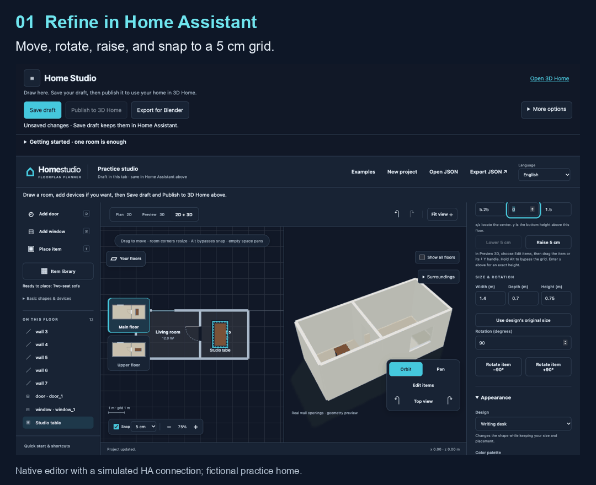
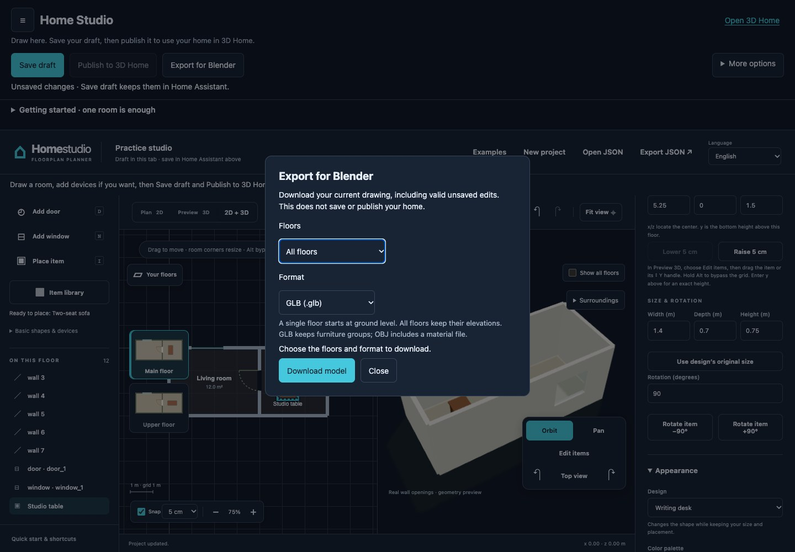

# From Home Assistant to Blender

Draw and refine the home in Home Studio, then download its geometry directly
from the Home Assistant editor. You do not need a terminal, a separate website,
or Blender installed on your Home Assistant server.

This workflow is available in the 1.1 beta line. Update the integration itself,
restart Home Assistant, and reload Home Studio; updating the public website
does not update an installed editor.

The editor images use its real HA host and sandbox with a simulated connection
and a fictional practice home. The final image is a Blender render of the
downloaded GLB with presentation lighting; it is not a recording of Blender's
interface. The steps below also work without the animation.
[Open the static Blender import image](media/blender-import.jpg).

## Prepare the drawing

1. Open Home Studio in the Home Assistant sidebar with an administrator account.
2. Draw a room, add furniture, and check it in Preview 3D or 2D + 3D.
3. Select a piece of furniture to change its position, dimensions, or rotation
   in Item details. Rotate item turns the furniture; Rotate view turns the
   camera. Use the 25 cm grid for broad placement or 5 cm for smaller changes.
   Hold Alt during a drag to bypass the grid, or turn Snap off.
4. Use the height handle or the numeric y field to raise or lower the item.
   Dimensions and positions are measured in meters. Undo restores a completed
   move; Escape cancels a drag before you release it.

The export includes the current valid drawing, including unsaved edits. It
does not save a draft, publish changes, or operate any Home Assistant device.
Finish or correct an invalid field before exporting. Keep a separate drawing
JSON backup if you want to continue editing in Home Studio later.

## Download the model

Choose Export for Blender in the editor toolbar, then select the scope and
format. Current floor is useful when working on one room or level. All floors
preserves their configured elevations in one model.

- GLB is the recommended format for Blender. It is one file containing the
  meshes, material colors, and object hierarchy. Each furniture item has a
  named parent at its placement point, with its individual parts beneath it.
- OBJ + materials downloads a ZIP. Extract it before importing the OBJ, and
  keep its MTL file next to it. Parts belonging to one furniture item share an
  object name, but OBJ cannot retain GLB's parent hierarchy and local pivots.

Stay connected to Home Assistant while the export is prepared. If another tab
has changed the saved project, Home Studio reports a revision conflict. Export
your drawing JSON before reloading if you need to keep the current edits.

## Open and edit in Blender

For GLB, choose File → Import → glTF 2.0 (.glb/.gltf), then choose the downloaded
file. In the Outliner, expand the floor and select the furniture parent, such
as Writing desk 1, to move or rotate the whole item. Selecting a child mesh
edits only that part. The furniture origin stays at the Home Studio placement
point; it is not an automatically computed center of mass.

For OBJ, extract the ZIP and choose File → Import → Wavefront (.obj). Keep the
matching MTL beside it so Blender can find the material definitions. The
OBJ uses meters with Z up and Y forward; select those axes in Blender's OBJ
importer. GLB's importer handles its axis conversion automatically. Check a known
room dimension before adding your own assets.

Use Material Preview to inspect material colors. Transparent surfaces and
lighting may look different from the live Home Studio renderer. You can add
Blender lighting, cameras, or more detailed materials and save a .blend file.
See Blender's [glTF import documentation](https://docs.blender.org/manual/en/latest/addons/import_export/scene_gltf2.html)
for its importer options.

## What the model contains

The export contains static geometry and material colors, not a live Home
Assistant dashboard. Device bindings, entity IDs, notes, credentials, camera
clips, television pictures, automation logic, and control buttons are not
included. Exported objects use generic floor names and catalog furniture names
rather than your private item labels.

The shape and measurements of your home are still present. Review the model
before sharing it publicly. Removing device identifiers does not make a floor
plan anonymous.

For an existing generated home, the exporter preserves the installed
architectural geometry and custom item meshes, then applies current supported
placements. It does not replace a detailed house with a generic reconstruction.
If the original geometry cannot be verified or is too large, export fails with
an explanation and leaves the drawing and installed home unchanged.

## Limits and troubleshooting

- There is no direct .blend export. Import the GLB or OBJ into Blender and save
  it as .blend there. Blender edits cannot currently be imported back as an
  editable Home Studio project; keep the drawing JSON as the authoring source.
- An export is a snapshot. Download again after making later changes. Old
  compiled download links reject changed placements instead of silently
  handing out a stale model; use Export for Blender for the current drawing.
- Large homes may exceed the bounded export budget. Try Current floor, or
  simplify overly detailed custom geometry. Only one build/export operation
  runs at a time, so let an existing operation finish before trying again.
- If the connection drops, continue editing and export drawing JSON locally
  as a backup. Save, publish, reload, and model export need a live connection.
  Reconnection does not automatically publish or replace your working drawing.

For the primary drawing workflow, return to the
[Home Assistant editor guide](home-assistant-editor.md). For access from outside
your home, use [Home Assistant's supported remote-access options](https://www.home-assistant.io/docs/configuration/remote/);
Home Studio uses the same HA address, login, and permissions.

## Verification for contributors

`python3 scripts/test-blender-export.py` exercises the actual export handler and
compiler with synthetic native and generated homes: current unsaved geometry,
custom assets, stale links, permissions, cancellation, limits, and floor heights.
Native browser tests separately exercise the real host, sandbox bridge, dialog,
download handling, connection loss, and recovery.

For an independent importer check, install the official `bpy` package into a
separate Python environment supported by that Blender release, then run
`python scripts/test-blender-import.py`. This optional check imports both GLB
and OBJ, compares their world bounds, checks materials and elevations, and
moves a furniture parent to verify that every part follows. Blender 5.2.3 LTS
with Python 3.13 passed this check during development. This is not a claim that
every Blender version or third-party importer has been tested. Blender and
`bpy` are not shipped with the integration and are not needed by HA users.
