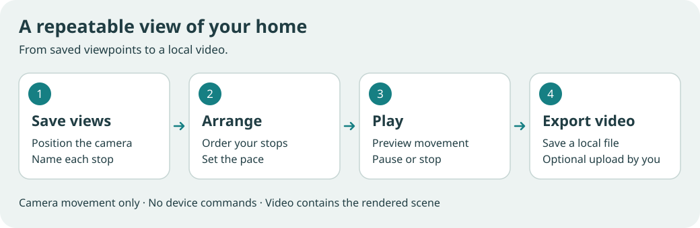

# Camera tours and local video

Camera tours save named viewpoints and replay them in an ordered route. Use
them to show a room, compare angles, or record a short walkthrough of your
model. They are available in the planner's 3D preview and the generated
Home/Editor viewer.

## Make a route

1. Open **Camera tour** in a 3D view. Position the camera with the usual orbit,
   pan and zoom controls, then select **Save current view**.
2. Give it a recognizable name, such as **Entrance**, **Living area** or
   **Garden**. Move the camera and add the next view.
3. Move views up or down to set their order. Preview a saved view to check its
   framing, or remove it if it no longer belongs in the route.
4. Set each view's duration. This is the travel time **from that view to the
   next**; the last view's duration is a hold at the end. New views use three
   seconds. A route supports up to 32 views and two minutes in total.
5. Choose **Play**, then **Pause** when you need to inspect a frame. Play resumes
   a paused route. **Stop** returns to the camera position from before the
   preview or playback. A completed route remains on its final view until you
   stop it or move the camera yourself.

Interacting outside the tour panel stops the tour. Manual camera navigation
keeps your new framing, including dragging, zooming and navigation controls.
The tour's animation loop runs only while playing; pausing or stopping it does
not leave a continuous camera animation running.

Movement eases between compatible views. The planner can include views on
floors that exist in the open project, with a cut when the floor changes.
Generated Home and Editor views each keep their own route for the current
floor; their routes cannot be mixed. Home uses a cut when the focused room
changes. Return from the map overview to the house before saving a Home view;
map navigation is not part of a tour. Opening another generated-viewer floor
ends that page's session.

The route controls the camera only. It does not move furniture, change the
drawing, or send Home Assistant service calls. It is not connected to security
camera entities or their live feeds.

## Keep your route

Routes are held **in this page session only**. Use **Export route** to save JSON
before reloading, closing the page or opening another generated-viewer floor.
Use **Import route** in the corresponding project/view to replay or edit it
again. Import replaces the current route, so export an existing route first
if you want to keep both.

Tour JSON contains names, timings, floor/room identifiers and camera poses. It
does not contain the home's geometry. Keep it with the corresponding drawing;
coordinates can frame the wrong place after geometry or floor heights change.
Planner, generated Home and generated Editor routes are scoped to their own
viewer type. Importing one into another viewer type does not convert its
coordinates or make it playable there.

Saving a planner project or publishing a home does not save this session's
route. Tour JSON is separate from inventory JSON, Home Assistant storage and
the GLB, OBJ, USDZ and DAE model downloads.

In Home Assistant, family access can create and play a route within the page
session. Route export and video recording require the host's existing download
permission; those controls are disabled when access does not allow downloads.
If that permission is removed, an active recording is discarded and its video
download is removed. Camera playback remains available.

## Export a video

Preview the route first, then choose **Record video** to play it from the
beginning and capture a local video. Recording finishes at the end of the
route; **Stop recording** saves an early take. The **Download video** link
remains available if the browser blocks the automatic download. Keep the page
visible while recording. The browser records the rendered
3D canvas: HTML room labels, device buttons, menus and other interface overlays
are not included. The recorder does not capture the microphone, system audio
or the rest of your screen.

Video encoding depends on the browser. Home Studio checks the available
formats and uses a supported WebM format, or MP4 when supported. The saved file
extension follows the actual recorded format. It does not convert WebM to MP4
or promise that every browser can record. If recording is unavailable, you can
still build, play and export the route as JSON.

Recordings are bounded to two minutes and 64 MiB. The recorder stops when its
duration limit is reached, the page becomes hidden or the video track ends.
Capture or encoding errors, loss of the graphics context and recordings above
the size limit discard incomplete output. A camera-navigation error stops the
route and finishes the current recording when the encoder can still complete it. Avoid changing the viewport size or
switching pages during a take; recording is a live capture and follows the
browser's rendering performance.

The file stays local until you choose to share it. You may upload it yourself
to a video editor or a video-generation service as a camera-motion reference,
if that service accepts the format. Camera tours have no provider connection,
automatic upload or AI-video generation step. An external service determines
how closely its output follows the reference.

## Implementation boundaries

The shared route engine in `camera-tour.js` validates a schema-1 document with
`waypoints`, each containing `id`, `name`, `duration` and `pose`. It owns the
play/pause/stop state, interpolation and temporary camera restoration. A
perspective pose records its floor, target, orbit angles and radius. A Home
pose records its floor, focused room, rotation, tilt, zoom and pan. Names are
limited to 80 characters, each duration is at least 0.25 seconds, and rejected
imports leave the existing route intact.

`camera-tour-panel.js` presents that engine; `camera-tour.css` styles its
controls. `camera-tour-session.js` connects playback, recording and downloads,
and caps camera updates at 24 frames per second. `camera-tour-recording.js`
owns canvas capture, format detection, the media stream and output limits.
Recording uses the canvas provided by its host, with no new renderer, remote
encoder or Home Assistant command path.

Each host loads the tools on demand and adapts its existing camera state.
`planner/camera-tour-adapter.js` connects the planner to callbacks that apply
poses to `orbit` in `planner/editor.js`. `camera-tour-viewer.js` creates the
separate generated Home and Editor sessions. Editor poses update the
radius/azimuth/polar/target state in `viewer.js`; Home owns its separate
orthographic navigation in `home-view.js`. Directly moving a Three.js camera
is insufficient because the next normal render rebuilds it from that state.
Camera ticks should request only the relevant 3D render and should reuse
geometry, materials and shadow maps.

Host cleanup stops playback and capture on page/view changes, graphics-context
loss and renderer disposal. A restored planner may replace its canvas, so
capture must resolve the current canvas when starting a new recording. Manual
navigation cancels the pending restoration before changing the camera.

Generated HTML embeds the runtime through `planner/project.py`; it must also
embed the tour modules and styles so the viewer works offline. The public
site/editor inventory in `scripts/validate-site.py`, companion inventory in
`ai_companion/assets.json` and compiler runtime in
`scripts/build-home-studio.py` must contain the corresponding sources. Model
exporters in `exporters.py` and `physical_exports.py` remain concerned with
geometry and materials; they do not encode this browser recording.

For regression coverage, exercise an ordered route in the public planner and
both generated views, pause/resume timing, Stop restoration, manual-navigation
cancellation, room/floor cuts, JSON round trips, and invalid imports. Check
that idle/paused/completed tours schedule no frames, camera playback does not
redraw the 2D plan, and hiding the page or losing the graphics context releases
capture resources. A real-browser recording check should decode a short saved
file and verify its MIME type, dimensions and nonzero duration, in addition to
testing unsupported formats and capture failures.
