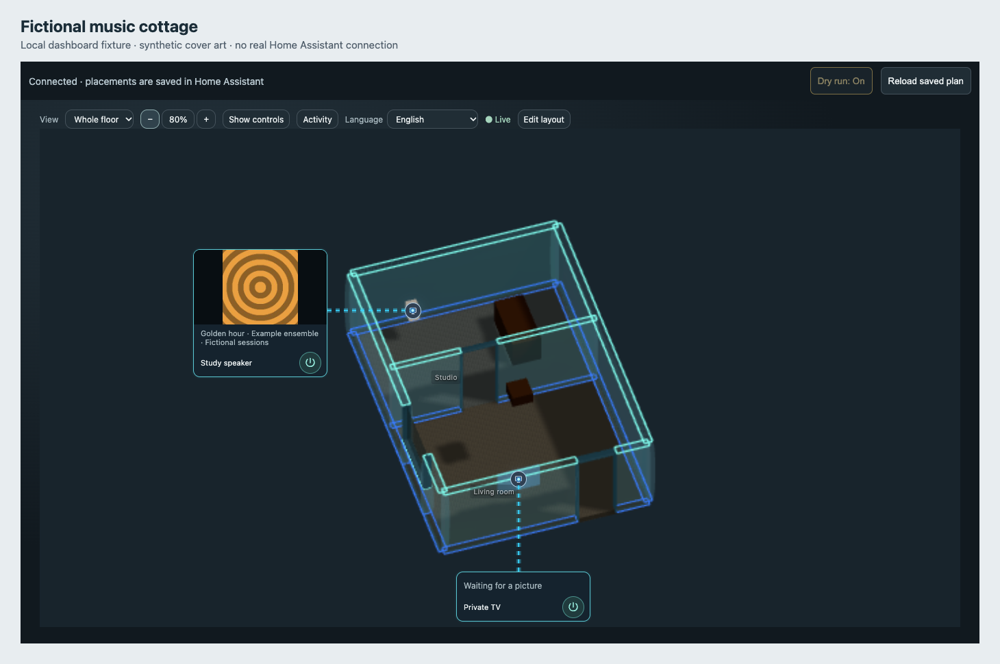

# Put your home on a dashboard, with media artwork

Dashboard cards and media artwork are included from 0.9.0. The current
integration also supports family accounts, with editing reserved for
administrators and device access checked against Home Assistant permissions.



The image above uses the real generated viewer with a local simulated HA session
and fictional media. It is an acceptance fixture, not a private home or live-device
verification.

## Upgrade the installed home first

For the recommended native installation, keep Home Assistant backups and
exported JSON copies, update the integration through HACS, and restart HA. Its
saved drawing and published assets live outside the code. Publish the saved
drawing again to regenerate it with viewer changes. New users should start
with the [native editor guide](home-assistant-editor.md).

For an existing portable installation, keep your exported project JSON and
project ID, make a Home Assistant backup, and rebuild with the current toolkit.
Follow the
[update instructions](https://ha-homelab.github.io/home-studio/install.html#updates)
and, for Home Assistant OS, the
[Samba transfer steps](https://ha-homelab.github.io/home-studio/install.html#haos).
Stop Core before replacing the component; check the configuration and start Core
afterward. Refresh the browser once the replacement is complete.

Updating the hosted drawing editor does not change a previously generated home.
The ordinary **3D Home** sidebar panel remains available after this upgrade.

## Add a dashboard card

1. Sign into Home Assistant as an administrator to configure the dashboard.
   Family accounts can use the published card without editing permission.
2. Reload the browser after installing or updating Home Studio. With the usual
   storage-managed dashboard resources, the integration registers its card
   module automatically. Existing resources are preserved.
3. Edit a dashboard, choose **Add card**, and select **Home Studio**. Its visual
   editor lets you choose a published floor by name, set the height, show room
   names, filter devices, hide the sidebar initially, and control Dry run and
   layout editing. New cards have **Lock layout editing** on.
4. Enable **Preview only (Dry run)** while checking your home and device bindings.
   Turn it off when you intend to use live controls. A remembered Dry run
   preference may still block commands; the card shows the active mode.

You can also configure the same options in the card's code editor:

   ```yaml
   type: custom:home-floorplan-card
   height: 600
   sidebar_collapsed: true
   dry_run: true
   edit_locked: true
   room_labels: false
   device_filter: all
   ```

`edit_locked: true` hides layout-editing tools even for administrators.
`room_labels` toggles room names; `device_filter: controls` hides passive sensor
markers while `all` includes them. These display choices do not change device
states, bindings, or account permissions.

Choose **Project default** in the visual editor to open the default floor, or
choose a named floor. **Refresh floors** updates the choices after publication.
Only published floors your account can read appear. If a selected floor becomes
unavailable, the editor keeps its setting and explains that you should choose
another floor. If the list cannot load, leave the fallback field empty for the
default floor or enter a known floor ID. No project JSON is needed.

For code-editor users, the optional `floor` field holds the floor **ID**, for
example `floor: main`. Omitting it uses the project default. You can still
switch floors inside the card.
`height` is a number of pixels from 240 to 1600; the default is 600.
`sidebar_collapsed` defaults to `true` to leave more room for the map.
Existing cards keep their saved choices and existing defaults; only newly
added visual cards start with layout editing locked.

If Home Assistant manages your **resources** in YAML, add the following entry
to the existing `lovelace.resources` list in `configuration.yaml` and reload
resources. This depends on resource mode, not on whether an individual
dashboard uses YAML. Do not add a second top-level `lovelace` key:

```yaml
lovelace:
  resource_mode: yaml
  resources:
    - url: /home-floorplan-static/card.js
      type: module
```

If automatic registration fails in storage mode, open **Settings → Dashboards
→ Resources** and add `/home-floorplan-static/card.js` as a **JavaScript module**.
Enable Advanced mode in your profile if Resources is not visible. If that
resource already exists, keep the existing entry and check its type rather
than adding a duplicate. The integration preserves existing resource URLs,
including version query strings, and retains its shared resource when unloaded.
Reloading the browser after an update fetches the current module from the
integration's noncached static route.

Each visible card owns a viewer. Prefer one card per view on slower devices.
Removing a card releases its viewer resources. The card reuses the existing
authenticated connection and opaque iframe boundary; it does not need an access
token in YAML, a public home URL, or a second copy of your project.

## Show cover artwork

In **Edit layout → Plan & placement**, link a suitable item to the real
`media_player` entity and wait for **Saved in Home Assistant**. Start media that
has cover artwork available in that entity's normal Home Assistant controls.
Return to **Home view**. The media callout displays available cover artwork and
track information when there is free space beside the plan.

When the player is off or has no image, its callout becomes a small round button.
Hover, focus or tap it to see the current status and available controls. Power is
a separate action inside those controls; hovering never turns a device on.

This is the album cover or other artwork supplied by the media integration.
It is not a screenshot of the TV, a video stream, or an automatic camera feed.
An existing private TV-capture adapter keeps priority for its configured screens.

The trusted host requests artwork from Home Assistant's own media-player proxy
using the current HA session. Only bounded JPEG pixels and display metadata
reach the viewer. Raw artwork URLs, media access tokens, and credentials are not
sent into the iframe. The media integration may itself contact its provider to
retrieve artwork, just as it does for the native Home Assistant media controls.

Up to 16 saved media-item placements are considered on each floor, with at most
two concurrent image requests. Images are reduced to at most 512 pixels per
edge; unsupported formats, oversized images, and animations are rejected.
Updates follow media changes rather than a background polling loop. Temporary
failures can keep the last good image for the same media identity. A different
track, an unavailable or off player, a removed binding, or disconnection clears
stale artwork. Images remain in memory and are not added to your project JSON.

## Troubleshooting

- **Custom element does not exist:** update or rebuild the installed integration, check that `/home-floorplan-static/card.js` loads, and register it
  as a JavaScript module. Then refresh the dashboard.
- **Access is restricted:** the user must be allowed to read every entity referenced by
  that floor. Adding a card does not bypass backend permissions; only
  administrators can edit its layout.
- **Wrong initial floor:** use the exact floor ID from your own project JSON.
- **Connection lost while loading:** the panel reloads the saved plan once Home
  Assistant reconnects. Ordinary state updates do not repeat the request. If a
  request still fails on a connected session, use **Reload saved plan**. Unsaved
  layout edits remain in the card for export; export them before confirming a
  reload. Reconnecting never repeats a save or device command.
- **No artwork:** check the media player's native HA controls and its saved
  binding. Unsupported, oversized, or malformed images are rejected. Off and
  unavailable players do not retain artwork. A busy or small layout may have no
  free space for a callout; enlarge the card or hide its sidebar. A failed initial
  artwork request is not retried continuously. Return to the tab after hiding it,
  reload the saved plan, or change media to start a fresh request.
- **Controls do nothing:** inspect the dry-run status and the entity's current
  availability. A card configured with `dry_run: true` cannot turn live controls
  on from inside that card.
- **Existing installation looks unchanged:** a new source download or hosted
  planner update is not an installed-viewer update. Update the native integration
  and publish the saved drawing again. For a portable installation, rebuild and
  replace the generated package, then restart Core.

Report the Home Studio version, browser, whether this is the sidebar panel or
dashboard card, and a small fictional reproduction. Do not attach your private
home layout, HA token, or media-proxy URL containing a token.
