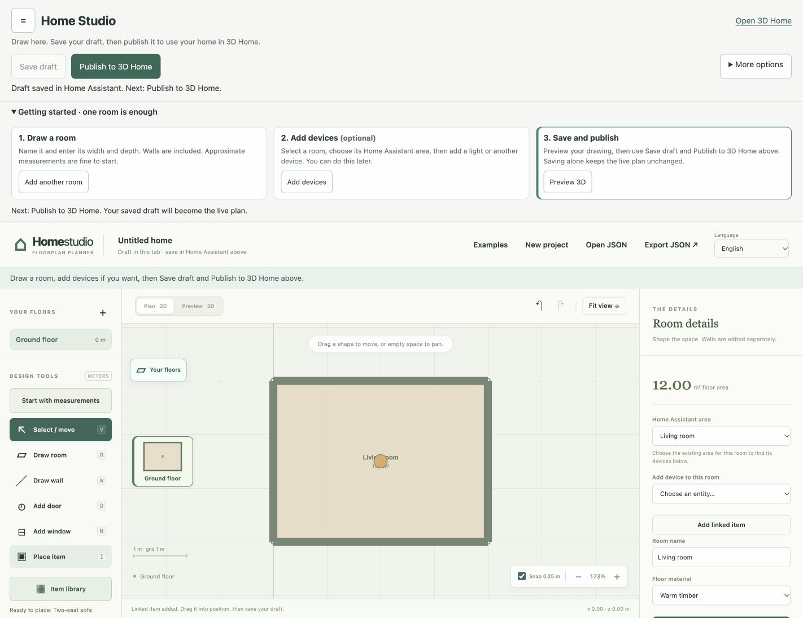

# Install, draw, and publish inside Home Assistant

Install Home Studio in Home Assistant, then start with one room. You can save
and publish that room before adding furniture or connecting any devices.

Use these two Home Assistant sidebar entries:

- **Home Studio** is where an administrator draws rooms, adds furniture, links
  devices, and saves and publishes changes.
- **3D Home** is the published view your household uses to see the home and
  control linked devices. Return to Home Studio when you want to change the drawing.

The steps below are for a new native installation, where the drawing is saved
inside Home Assistant. No terminal or local compiler is needed. If you already
use a generated or customized home, read [Existing generated homes](#existing-generated-homes)
before changing its installation. The separate editor remains an optional
fallback for offline work or while resolving HA setup.

The native workflow requires Home Assistant 2026.10 or newer and a release with **home_floorplan.zip**. A release
that only contains **home-studio-VERSION.zip** provides the portable toolkit.
Check the release assets rather than assuming a hosted editor update changes
an installed Home Assistant integration.

This screenshot uses the actual editor and trusted host with a simulated HA
connection and fictional devices. No personal home or credentials are shown.

## Install the native integration

1. Back up Home Assistant. If you already use a generated or customized
   `home_floorplan` component, read **Existing generated homes** below first.
2. In HACS, add `https://github.com/ha-homelab/home-studio` as a custom repository
   with the **Integration** category. Download Home Studio from a release containing
   **home_floorplan.zip**. Inclusion in the default HACS catalog is not required.
3. Restart Home Assistant once after installing the integration code.
4. Open **Settings → Devices & services → Add integration** and choose
   **Home Studio**. A new native installation needs no terminal, Python, API token,
   or YAML entry.
5. Open **Home Studio** in the sidebar using an administrator account.

For manual installation, extract the contents of **home_floorplan.zip** into
`config/custom_components/home_floorplan`, then follow steps 3–5. Do not put
the source-toolkit ZIP there. Keep only one installed copy of the domain.

## Your first working room

For your first drawing, use a desktop browser with a mouse or trackpad. Start
with an empty floor. If a saved drawing opens, continue working on it instead;
use **More options → Export drawing (JSON)** to keep a copy before replacing it.
The short guide in Home Studio follows three steps: **Draw a room**,
**Add devices (optional)**, and **Save and publish**. Expand **Getting started ·
one room is enough** if it is closed. Once you have a room, the first shortcut
becomes **Add another room**.

1. Choose **Add your first room**. Enter **Room name**, **Width (m)**, and
   **Depth (m)**. For practice, try a room four meters wide and three meters
   deep. For your own room, use your measurements. Leave **Include walls**
   checked and choose **Create room**.
2. Choose **Preview 3D** to check the floor and walls. Doors, windows,
   furniture, and devices can wait until this first room works.
3. Choose **Save draft** and wait for confirmation that the drawing was saved
   in Home Assistant. You can leave and continue this saved drawing later.
4. Choose **Publish to 3D Home** and wait for confirmation. This updates
   **3D Home** from the saved drawing. Each floor needs at least one valid room;
   a failed publication leaves the previous published home available.
5. Choose **Open 3D Home**, or open **3D Home** in the HA sidebar, to see your room.
   Return to **Home Studio** to add more detail, then save and publish again
   when ready.

**Save draft** keeps your work for editing. **Publish to 3D Home** makes the
saved drawing visible in 3D Home. An unfinished draft can be saved without
changing what your household sees. Neither action operates devices.

For pictures of the drawing tools and a two-room example, follow the
[illustrated drawing guide](../planner/guide.html).

## Add your first device

1. In **Home Studio**, choose **Add devices**, select the room, and choose its
   **Home Assistant area**. This helps find devices already set up in HA; it
   does not measure the room or find their positions.
2. Under **Add device to this room**, choose a light and select **Add linked
   item**. Drag the new item to its place in the room. The list uses HA
   entities: the lights, switches, sensors, and other controls or readings
   already in Home Assistant.
3. **Save draft**, then **Publish to 3D Home**. In **3D Home**, enable
   **Dry run** before trying the lamp's controls. You can check its link without
   sending commands. Turn Dry run off when you want to operate the real light.

Use **Item library** to add furniture that is only part of the drawing; you
can leave **Entity ID (optional)** empty. A lamp model does not create a new
device in Home Assistant.

## Saving while you work

**Save draft** also applies the value you are currently typing. Unfinished
fields count as unsaved work. If a field is invalid, saving and publishing
stop, and Save draft focuses the field so you can correct it without losing
your entered text. The tab recovery copy contains accepted drawing changes;
correct unfinished fields before leaving the editor.
**More options → Export drawing (JSON)** downloads a backup of the last valid
drawing and tells you when invalid field text is excluded. **Load saved draft**
is also under More options; export your work first if you need to keep the
current edits before loading the saved copy.

## Everyday controls without editing access

Use the **3D Home** panel or the [dashboard card](dashboard-and-media.md) for
everyday operation. The editor, project publication, and saved layout changes
remain administrator actions. A dashboard can lock editing even for an
administrator account.

Home Assistant permissions still apply. A user who cannot read an entity used
by a floor cannot load that floor's embedded model; the integration does not
send a partially redacted model containing hidden entity identifiers. For
readable entities, the host also checks control permissions before exposing
commands. Removing the edit buttons alone is not the authorization boundary.
The host indexes model entity references when loading or publishing a generation,
outside Home Assistant's event loop. Each request still checks current placements,
curtain guards, and user permissions. A failed index build leaves the previous
published generation active.

## Updates, backups, and concurrent editing

- The native project and its published assets live in HA's private data,
  outside the installed integration code. Update the integration through HACS
  and restart when HA requests it; keep HA backups and exported JSON copies.
- Save and publish use revisions. If another tab changes the same project,
  export the version you want to retain before reloading. A conflict does not
  silently choose one user's drawing over another.
- Integration updates replace code. Publish the saved drawing again when you
  need newly compiled viewer changes; updating the hosted website does not
  update your installed home.
- If publication fails, correct the reported field and publish again. The
  last successful dashboard stays available.
- If the connection drops, do not treat an unsent draft as saved. Keep an
  exported JSON copy before closing the editor.

## Optional fallback: the separate editor

If setup is blocked, or you want to work offline, use the separate editor.
The in-HA editor links to the [hosted browser editor](https://ha-homelab.github.io/home-studio/planner/);
a local copy is available in the portable toolkit.
The separate editor links back to the native installation instructions. It
does not know your private HA address, connect to HA, or receive your project
just because you follow that link.

To move a design deliberately, use **More options → Export drawing (JSON)**
in Home Studio, or **Export JSON** in the separate editor. Then use **Open JSON**
in the other editor. Check the imported drawing, save it, and publish when ready.
The external editor keeps its own browser draft; the native editor stores its
saved source in HA. Neither silently overwrites the other.

## Draft from photos without leaving Home Assistant

If the AI option is available, choose **Draft from photos (AI)** in Home Studio
to open **Plan from photos**. Select your provider,
exact vision-model ID, and session-only key (the field is masked). Connect, choose
an existing measured room or enter a new rectangular room's dimensions, and add
photos and instructions. **Generate draft** sends the selected input to that model.
Review the detached 2D/3D proposal, correct dimensions, confirm, and **Apply selected
additions**. Then **Save draft → Publish to 3D Home**; no JSON transfer is needed.

Only administrators can create AI sessions. The provider key stays in HA process
memory for at most 30 minutes, is cleared on **End session**, and is not persisted
in your drawing, browser storage or HA configuration. The key is sent to your chosen
provider to authenticate; photos and sanitized room context are sent on Generate.
Use HTTPS when connecting to HA remotely. An API key does not grant an AI model any
Home Assistant service access. Failed or cancelled generations leave the plan intact.

The [full AI guide](ai-planning.md) explains limits, privacy and providers. The
optional desktop companion remains available for separate editing. For native
local-model profiles, `127.0.0.1` means the HA host/container, not your laptop;
LAN model URLs are not accepted by these profiles.

## Existing generated homes

The portable workflow is retained: external editor → JSON → Python compiler →
local installer. Its [build and installation instructions](../install.html#export)
continue to apply. Generated packages and specialized private adapters are not
automatically converted into native projects.

Do not replace a customized component with the generic HACS package and expect
its private adapters or prebuilt assets to be preserved. Keep its existing
deployment route unless you intentionally migrate. For an ordinary portable
project, retain its source JSON and HA backup, then import the source into a
fresh native installation. Check bindings in Dry run before using live controls.
If Home Studio identifies the installation as a generated home, its sidebar
explains this workflow and keeps the family view and browser editor links
available. This compatibility state is not a connection error.

## Troubleshooting

### Unable to load custom panel

If Home Assistant reports **Unable to load custom panel**, open the browser's
developer tools, select **Network**, and reload the panel. Inspect the failed
`/home-floorplan-static/studio.js` or `panel.js` request, including its HTTP
status, redirects, response body, and `Content-Type`. Preserve any unsaved drawing
in a working tab before reloading it.

- **401 or 403:** access was refused before the module could run. Check your HA
  login and any reverse-proxy login or access policy. If other HA routes also
  fail, investigate access first. A working local connection and failing remote
  connection can help isolate the affected route; they do not prove an IP ban.
  Check HA logs and `ip_bans.yaml` in the configuration directory for the actual
  client address, including IPv6. For a confirmed accidental ban, back up that
  file, remove only the matching client entry, and restart HA. Correct the client
  or stale credentials causing failed logins before retrying repeatedly. Keep
  authentication, IP banning, and unrelated bans enabled. See
  [Home Assistant's IP-ban guidance](https://www.home-assistant.io/integrations/http/#ip-filtering-and-banning).
- **404:** check that the requested file exists in the installed component and
  that HA loaded that component successfully. A reverse proxy may have cached a
  temporary 404 while HA was starting. Compare the local response with the
  external response and inspect `Age` and cache-status headers before reinstalling.
  Bypass shared caching for `/home-floorplan-static/`, `/home-floorplan-studio/`
  and `/api/home_floorplan/`, then purge the affected module URLs. This changes
  caching only; retain the same authentication and access policies. If the file
  is actually missing, reinstall the complete matching release, then restart HA
  and reload the browser. Customized installations
  must use their existing package/deployment route. Do not copy individual
  scripts from a different release or replace private assets with a generic ZIP.
- **200 with HTML, or an unexpected MIME type:** a login page, proxy fallback,
  or cached error may have replaced the JavaScript response. Fix that route or
  cache rule so the module URL returns JavaScript with a JavaScript content type.
- **200 with JavaScript:** inspect the first relevant **Console** error and any
  failed imported modules. Record the browser version, installed release, and
  sanitized error; a syntax or module-loading error needs different diagnosis
  from an access refusal.

After fixing the cause, reload the panel and confirm its module loads. Do not
publish access tokens, cookies, client addresses, or full private logs in a report.

### Other setup and editing problems

- **No Home Studio integration in the picker:** check that you installed the
  native ZIP into the correct domain directory and restarted HA. The toolkit
  ZIP is a separate download.
- **No editor for a family account:** project editing requires an administrator.
  Open the 3D Home panel or a dashboard card for normal controls.
- **No device suggestions:** check the room's HA area and whether its devices
  are enabled. An area mapping is optional; an entity can be selected directly.
- **Save succeeds but Publish fails:** saving allows an unfinished drawing;
  publication requires complete, valid geometry. Follow the field named by
  the error. The previous publication is retained.
- **Publish to 3D Home is unavailable:** save your latest changes and check
  that every floor has a room. The message below the guide explains the next
  step. **Open 3D Home** becomes available after your first successful publication.
- **The drawing tools do not finish loading:** after a short wait, use
  **Retry connection** to reopen the preserved drawing. Retry does not replace
  a recovered drawing with the saved HA version.
  **More options → Export drawing (JSON)** remains available when the host has
  a drawing, including after an editor load error.
- **The external editor opens a different draft:** this is expected. Export
  and open the JSON file when you want to transfer a design.

When requesting help, include the Home Studio version and whether you used the
native integration or portable toolkit. Use a fictional reproduction instead
of posting a real home's drawing, entity list, photos, or credentials.
