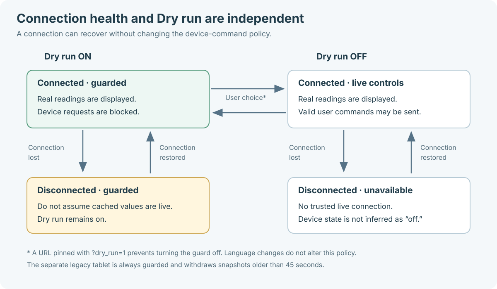
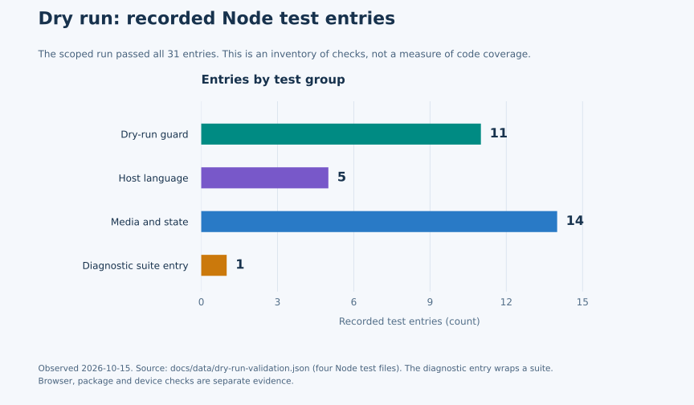

# Dry run: process, results and evidence

The installed plan now has a visible, persistent guard for device actions,
translated feedback, and operating instructions that travel with its source
archive. A guarded click reports **no command sent** while the plan continues
to show real Home Assistant readings. This page connects the implementation
decisions to the checks that support them.

This is an implementation and validation record, not a release announcement.
The recorded work is reviewed in [pull request #29](https://github.com/ha-homelab/home-studio/pull/29).
Consult that pull request and the [release guide](../RELEASING.md) for current
review, CI, and publication status. The results below describe the local
verification recorded on **15 October 2026**; they do not certify later changes.

For current setup, [install Home Studio, draw, and publish inside Home Assistant](home-assistant-editor.md).
The process and diagrams below record delivery of the Dry run feature, not the
steps required to install or publish a home.

## The delivery process


1. **Define the boundary and translate it.** Put the device-command guard in
   the authenticated host, outside the viewer iframe. Generate the host's
   messages from the same bundled locale catalogs used by the viewer, keeping
   language selection separate from the device policy.
2. **Prove blocked calls stay blocked.** Exercise the production message
   handler against fake Home Assistant services. Check action families,
   unexpected messages, native details dialogs, stale viewer generations,
   and a click queued just before the guard turns on. Assert zero service calls
   for blocked requests, rather than inferring safety from a disabled button.
3. **Exercise actual browser behavior.** Use a local HTTP origin to test
   storage, reloads and sibling tabs. Verify that denied storage cannot silently
   enable controls. Check translated feedback and a narrow right-to-left layout
   without changing the user's model or losing the URL pin.
4. **Package the instructions with the code.** Validate README coverage,
   relative links and accessible SVGs. Extract the generated source archive
   and validate its documentation again, so a working repository does not hide
   missing files in the download.
5. **Make the change reviewable.** Submit signed source changes with the
   behavior, evidence and limitations recorded together. Reviewers can inspect
   the guard, tests, diagrams and translations in one revision.
6. **Require release acceptance.** A local test pass is input to review.
   Required CI and release acceptance still decide whether an artifact is
   eligible for publication. Follow the release process for the specific
   candidate; do not infer publication from this diagram.

## What changed for a person using the plan

**Device-button experiments now have an explicit mode.** Normal controls
previously provided a route to real device operations. With Dry run enabled,
the host stops device requests and releases pending feedback without fabricating
a new lamp, lock or curtain state. Normal controls remain available when the
guard is intentionally off and the usual connection and command checks pass.


**The choice survives ordinary browser use.** The preference persists after a
reload and changes propagate to other open plan tabs on the same origin.
Unreadable or invalid storage starts guarded; a failure to save “off” leaves
the current page guarded. A URL pinned with `?dry_run=1` remains guarded even
when a sibling tab switches to live controls. A fresh browser with readable,
empty storage and no pin still starts with normal controls: the guard is not an
account-wide policy.

**Everyday host feedback follows the chosen language.** The original host
feedback for this feature was English-only. The host now uses **23 common UI
messages across the 24 viewer locales**, including Dry run feedback and relevant
command errors. Language changes also update existing notices. Arabic, Persian
and Hebrew use right-to-left interface direction. The user's room names, entity
IDs and project content remain their own text.

**A lost connection is visible without weakening the guard.** Connection health
and device-command policy are independent. Reconnection can restore live readings
while Dry run remains enabled; a missing reading is not interpreted as “off.”



**The operating knowledge is downloadable.** Detailed guides, localized README
quick starts, a repository-local wiki and source SVGs are included in the
explicit source archive inventory. The [wiki home](wiki/Home.md) is a set of
reviewed repository files, not a separately published GitHub Wiki. English is
the detailed reference language; [localized quick starts](translations/README.md)
cover all 24 supported languages.

## Recorded checks and what they establish

- **31 Node test entries passed in the recorded run.** The four source files
  report 11 Dry run guard entries, 5 host-language entries, 14 media/state
  entries and 1 diagnostic suite entry. The last entry wraps its own suite.
  These counts describe the runner output, not the number of assertions, a
  percentage of all possible behaviors or a device fleet certification.
- **Real-browser checks passed for the Dry run storage path.** The browser
  suite covers on/off persistence, cross-tab changes and removal, URL pinning,
  denied storage, translated feedback and a narrow RTL header. Existing lock
  and curtain regression checks also passed. These fixtures use fake services;
  no real household device operation is needed to verify the guard.
- **The locale checks cover 24 viewer catalogs and 23 shared host messages.**
  Catalog structure and placeholder checks catch missing or inconsistent keys.
  They do not establish native-speaker fluency or imply that advanced diagnostic
  text and every reference document have been translated.
- **Documentation validation checks the shipped files.** Local links, locale
  README coverage, SVG metadata and safe static content are checked in the
  repository and in an extracted source archive. The process does not replace
  a visual inspection of each diagram or a review for accidentally included
  private information.



The chart uses the recorded [validation data](data/dry-run-validation.json),
rendered by the [chart generator](../scripts/render-validation-chart.py).
Different suites group their work differently: comparing these bars does not
measure relative coverage or feature importance. The counts are a dated
snapshot, not a promise that every future revision passes.

To reproduce the checked-in SVG, use Python with Matplotlib 3.11.2 in a separate
development environment, then run the generator from the repository root:

```sh
python3 -m venv .venv-docs
.venv-docs/bin/python3 -m pip install matplotlib==3.11.2
.venv-docs/bin/python3 scripts/render-validation-chart.py docs/data/dry-run-validation.json docs/images/dry-run-validation.svg
```

On Windows, use `.venv-docs\Scripts\python.exe` in place of
`.venv-docs/bin/python3`. Matplotlib is a documentation-generation dependency;
neither the plan nor the installer needs it. Update the dated source data only
after recording a new test run. Regenerating the figure does not query live CI
or execute the tests.

The primary reproducible commands are below. Browser commands require the
development dependencies and browser installation described in the
[README](../README.md#checks-and-publication).

```sh
node --test scripts/test-dry-run.cjs scripts/test-panel-language.cjs scripts/test-media-preview.cjs scripts/test-module-expiry.cjs
node scripts/test-dry-run-browser.cjs
python3 scripts/build-panel-locales.py --check
node scripts/test-viewer-i18n.cjs
python3 scripts/test-docs.py
python3 scripts/validate-docs.py
python3 scripts/test_package_release.py
```

See [development and validation](wiki/Development.md) for the broader source map
and [translation contributions](i18n.md) for language-specific checks. Record
the commit, command output, browser/OS and observed limitations when reproducing
results for another candidate.

## Limits to keep visible

Dry run protects device requests made **through this plan**. Other Home
Assistant dashboards, automations and already-delivered commands remain outside
its boundary. It also permits saved layout edits; use a copied project when
experimenting with placement. It is not a touch lock or full-screen kiosk.

This work reports no rendering-speed, memory, battery-life or network-throughput
measurements. The diagrams explain behavior and delivery; they are not benchmark
graphs. Desktop browser verification does not prove native Android acceptance.
The separately maintained legacy tablet uses a read-only snapshot interface
and needs its own signed-build and physical-device checks.

Start with [the Dry run operating guide](dry-run.md) to enable the feature, or
[troubleshooting](wiki/Troubleshooting.md) when the indicator, storage or live
readings do not behave as expected.
