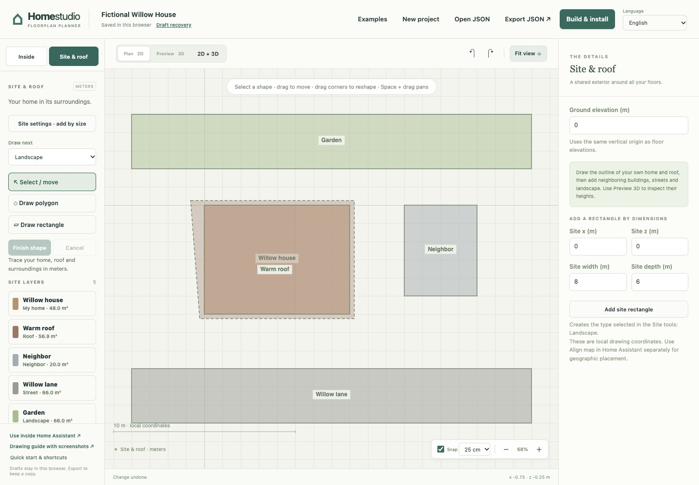
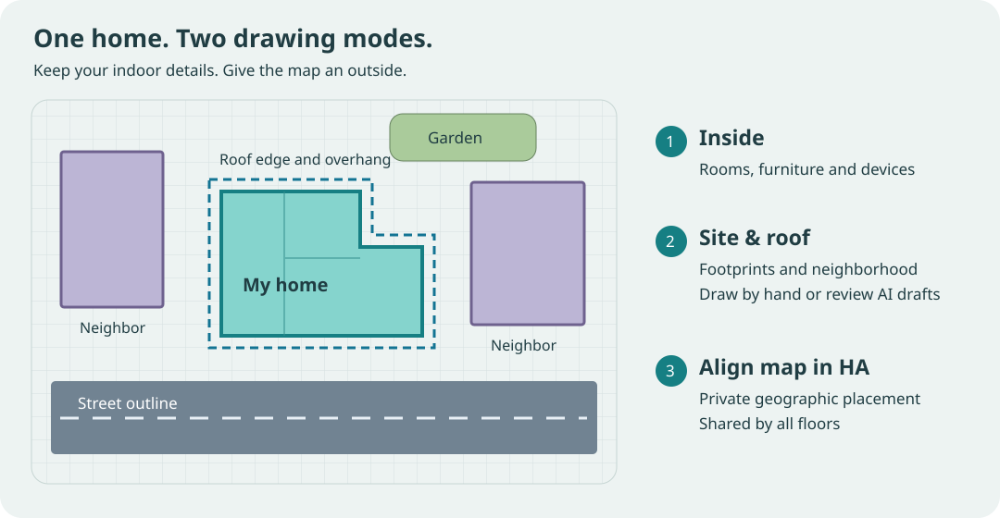
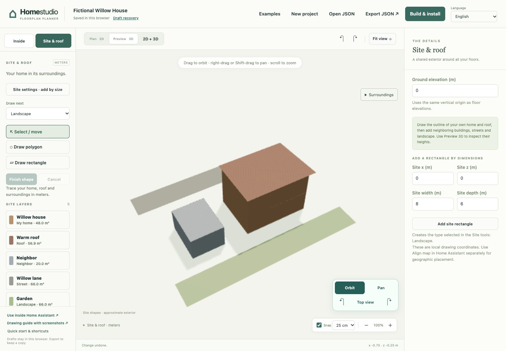

# Draw your home and its surroundings

**Site & roof** is a separate drawing mode for the outside of your home. Use it
to draw the building footprint, a roof outline, nearby buildings, streets, and
green spaces. **Inside** keeps the room, furniture, and device editing workflow.
Both modes belong to the same saved project.

The left panel chooses what to draw, the center shows the shared grid, and the
right panel edits dimensions. Select **Site settings · add by size** to enter
a measured rectangle, or use **Draw polygon** to trace individual corners.

You can sketch and save the site before drawing the rooms. Publishing a full
home still requires at least one room on each floor; site shapes provide its
outside context rather than replacing that floor structure.

## Start with your own building

1. Open your drawing in Home Studio and select **Site & roof**. The existing
   floors provide a faint reference underneath the exterior drawing.
2. Choose the **My home** type. Draw a rectangle for a simple footprint, or
   click the corners of a polygon for a more complex shape. Finish the outline
   with **Enter**; **Escape** cancels an unfinished shape.
3. Give it a useful name and set its height in metres. Keep the outline aligned
   with your rooms: the site and all floors use the same X/Z drawing grid.
4. Choose **Roof** and draw its outside edge. Include an overhang if your roof
   extends beyond the walls. Set its height above the site's ground.
5. Check **Preview 3D** or the split view. Return to the drawing to move a shape,
   drag a corner, or enter precise point coordinates. **Undo** also works for
   site edits.

The roof is a horizontal reference outline/surface at the entered height. It is
not a pitched-roof construction tool: ridges, rafters, roof slope, and detailed
roof tiles are not inferred from a footprint.

The preview checks relative heights and placement. Drag to orbit, use Shift-drag
to pan, and scroll to zoom. These screenshots use invented geometry and contain
no real home's location or private device data.

## Add the neighborhood

Select **Neighbor** for another building, **Street** for the paved road outline,
or **Landscape** for a garden or green space. Name shapes so they are easy to
find again. A street is a closed outline of the road surface, rather than a
single centerline. Streets and landscape shapes stay at ground level.

Start with the nearest few buildings. Simple outlines with four to ten corners
usually provide enough context. You can select a shape from the list, adjust
its color and height, or delete it without changing any indoor objects or
Home Assistant entity bindings.

You can draw these outlines manually from known measurements and permitted
references, without an AI account or key. Check their position on the shared
grid before using the separate Home Assistant map alignment.

The supported envelope is 64 shapes, 64 corners per shape and 1,024 corners in
total. Coordinates extend 1,000 metres each side of the drawing origin. Keep
individual polygons simple: their edges must not cross, fold back, or repeat
the first point at the end. Separate polygons may overlap, for example a roof
over a house or a garden beside a street.

## Choose reference imagery

Use your own photos or references licensed for your intended use, including
submission to your selected AI provider. Keep required source attribution when
showing or sharing imagery. A private project or personal API key does not grant
additional rights to someone else's images.

- **Google Maps screenshots:** Google's [image-use guidelines](https://about.google/brand-resource-center/products-and-services/geo-guidelines/)
  permit adding labels and graphics to ordinary Maps screenshots with attribution.
  That permission is not a general license for automated geometry extraction.
- **Google Street View:** the same guidelines prohibit screenshotting Street View
  and using applications to extract information from it. Use your own street-level
  photographs for this workflow.
- **Google Maps Platform imagery:** the [API terms](https://cloud.google.com/maps-platform/terms)
  prohibit deriving building outlines from its satellite imagery. Home Studio does
  not fetch Google imagery or provide a Google footprint-extraction service.

[OpenStreetMap data](https://www.openstreetmap.org/copyright) can provide an open
reference; retain its attribution and license notices and review the ODbL terms
before redistributing derived data. Draw only the local context you need and
check dimensions independently.

## Draft from photos with your own AI

Open the optional AI panel and choose the site/roof mode. Select the photos or
permitted reference images you want to send and identify your home in words.
Include a measured distance, the relationship to the existing drawing, and which
nearby objects to include. For example:

> My home is the white building in the center of photo 1. Its front wall is
> 8 metres wide and runs along X from 0 to 8; the street is on the negative-Z
> side. Draw my home's footprint and roof edge, the two buildings immediately
> to its left and right, and the street in front. Do not include buildings in
> the distance. The eaves are about 6 metres above ground. Mark uncertain
> dimensions as estimates.

A street-level photo does not reveal hidden roof edges, exact distances, or
surveyed property boundaries. Review the proposed shapes and the AI's stated
assumptions before applying them. Add a top-down reference and another measured
distance if the first result is unclear. You can keep only the useful proposed
shapes. Applying a site draft adds selected site features and preserves your
existing interiors; it does not redraw your rooms or change entity bindings.

AI uses the existing [provider connection](ai-planning.md) and photo preparation
flow. A cloud provider receives your selected photos, instructions and the
displayed planning context; a local model receives them through its configured
endpoint. Credentials are session-only. Neither photos nor credentials are
saved inside the drawing. Applied shapes are saved with the project and exported
viewer, so keep real neighborhood projects and backups private. Ending the session
clears Home Studio's selected photos and credentials; it cannot delete provider
records. No AI result sets GPS coordinates or silently changes the Home Assistant
map alignment.

## Show it on the Home Assistant map

Drawings with a `site` property require **v1.2.0-beta.6 or newer** in both the
toolkit and Home Studio integration, even when the site has no shapes. The
v1.1.0 stable release and v1.2.0-beta.5 cannot read these drawings. Choose a
compatible version from [the releases](https://github.com/ha-homelab/home-studio/releases);
for local builds download its `home-studio-VERSION.zip` asset, not the Source
code ZIP. Keep this version requirement when following the installation guide,
which normally points to the latest stable release. If a suitable release is
not yet available, keep your exported JSON; preview releases are optional.

Save and publish the drawing as usual. In the native **3D Home** view, an
administrator can use **Align map** to align a known drawing point with its
geographic location. Follow the [map alignment guide](map-navigation.md).

The exterior shapes appear as you move out from the indoor view into the map
overview. Detailed indoor controls remain the focus at house scale. The site
uses the existing renderer and lightweight geometry; it does not add another
map renderer or a continuously animated background.

Site shapes use local metres and are included in your drawing's JSON backup and
generated viewer. Geographic latitude, longitude and north alignment remain
in HA's separate private map settings. A drawing of your actual neighborhood
may still identify its location, so use a fictional example for public demos.
The separate browser editor can draw and preview the site without map access;
geographic tiles still require the native HA host.

## If something looks wrong

- **The site is shifted from the rooms:** check the shape's X/Z coordinates.
  Changing map alignment moves the whole model relative to the map; it does not
  fix a footprint drawn in the wrong place within the project.
- **The roof is too low:** roof height is measured from the site ground, not
  from the currently selected floor. Check the ground elevation and roof height.
- **An outline is rejected:** remove repeated corners and crossing edges. A
  closed outline needs at least three distinct corners and some area.
- **Shapes are missing from an older installed view:** update the integration
  and publish again. Externally generated viewers need a rebuild using the
  updated toolkit, as described in the map guide.
- **An AI shape is inaccurate:** discard or edit it. Photos provide visual
  evidence, not guaranteed dimensions. Applying a draft is always explicit.

## Portable data contract

Existing version-1 projects continue to work without a `site` property. New
projects may add `site.ground_elevation_m` and a `site.features` array. Each
feature contains `id`, `name`, `kind`, `polygon`, `height_m`, and `color`.
`kind` is `home`, `roof`, `building`, `street`, or `landscape`; `polygon` is a
list of `[x, z]` pairs. Heights are 0–100 m, ground elevation is −100–100 m, and
colors use `#RRGGBB`. Unknown fields, invalid numbers, and malformed outlines
are rejected by both the JavaScript editor and the Python compiler.
